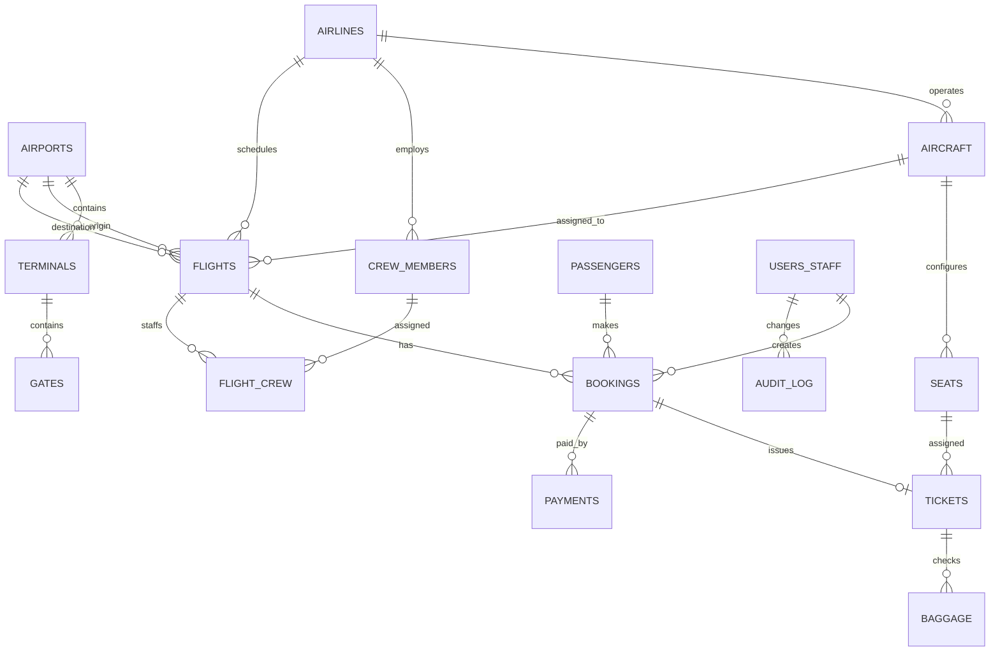
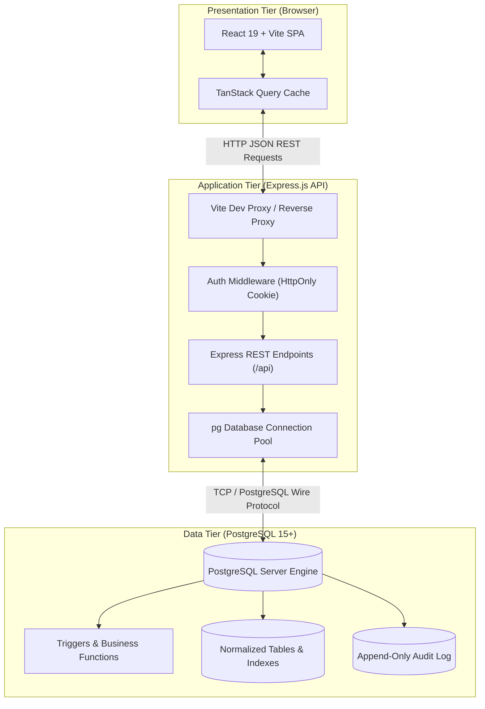

# Airport Management System: Database Architecture, Relational Design, and Transactional Integrity

**Course:** Advanced Database Management Systems (DBMS)  
**Platform:** PostgreSQL 15+ (`citext` extension)  
**Application Architecture:** Three-Tier Architecture (Express.js API via `pg`, React + Vite Frontend)

---

### Abstract
This project report documents the design, theoretical normalization, physical implementation, transactional concurrency control, and system architecture of the **Airport Management System (AMS)**. Built upon a PostgreSQL 15+ relational database engine, the system coordinates international airport operations, multi-carrier flight schedules, fleet inventories, physical seat maps, passenger itineraries, atomic booking issuance, fare processing, checked baggage manifests, role-based personnel management, and system-wide operational auditing. 

The physical data model comprises 16 normalized relations, 6 PostgreSQL enumerated types (`ENUM`), 15 performance-oriented secondary B-Tree indexes, 1 partial unique index for flight seat allocation, 4 relational views, 3 procedural PL/pgSQL business functions, and 3 event triggers. The report demonstrates that the schema adheres rigorously to Third Normal Form (3NF) and Boyce-Codd Normal Form (BCNF), preserving operational dependencies while isolating mutable temporal facts. High-concurrency seat reservation is guaranteed through explicit row-level locking (`SELECT ... FOR UPDATE`) paired with a partial unique index, preventing race conditions and double-booking anomalies under the `READ COMMITTED` isolation level. System access is secured via parameterized SQL queries, signed `HttpOnly` session authentication, and database-level masking of sensitive traveler credentials.

---

## 1. Title Page and Abstract

* **Project Title:** Enterprise Airport Management System (AMS): A Relational Database Engineering Implementation
* **DBMS Engine:** PostgreSQL 15+ with `citext` Extension
* **Target Environment:** Node.js/Express API (`pg` Driver) & React/Vite Client
* **Keywords:** Relational Database Design, Boyce-Codd Normal Form, Concurrency Control, Partial Unique Indexes, Row-Level Locking, Database Triggers, PL/pgSQL, Audit Logging.

---

## 2. Introduction

### 2.1 Problem Statement
Modern aviation and airport logistics present one of the most operationally demanding environments in data management. Airport ground operations, scheduled carrier flights, passenger reservations, boarding gates, and ground baggage handling operate in continuous, real-time synchronization. Operational failures—such as double-booking an aircraft seat, dispatching overlapping flights to a single boarding gate, losing track of checked baggage, or recording revenue without issuing an accompanying ticket—lead to regulatory penalties, logistical bottlenecks, and financial losses. 

A central challenge is the coordination of shared physical resources across legally distinct corporate entities. Multiple airlines share terminals and gates owned by municipal airport authorities, while travelers interface with third-party aggregators and carrier booking channels. The underlying data management system must ensure absolute transactional consistency, enforce complex business constraints across multiple foreign keys, and guarantee that concurrent reservation requests never compromise data integrity.

### 2.2 Objectives
The primary objectives of this project are:
1. **Develop a Normalized Relational Schema:** Construct an enterprise-grade schema modeling airlines, aircraft, airports, terminals, gates, crew, flights, passengers, bookings, tickets, payments, baggage, staff, and audit history.
2. **Guarantee Data Integrity via DBMS Constraints:** Enforce domain, entity, and referential integrity directly inside the database engine using check constraints, custom enumerated types, regular expression pattern validators, composite foreign keys, and unique indexes.
3. **Achieve Transactional Atomicity and Isolation:** Implement atomic reservation and cancellation procedures in PL/pgSQL that manage payments, seat assignments, and ticket issuance within isolated database transactions.
4. **Prevent Race Conditions:** Eliminate concurrency anomalies (specifically double-booking physical seats) using multi-layered concurrency defenses, combining pessimistic row-level locking (`SELECT ... FOR UPDATE`) with declarative partial unique indexing.
5. **Implement Comprehensive Operational Auditing:** Capture append-only transactional change logs with JSONB document snapshots to record historical booking states and attribute modifications to verified personnel.
6. **Provide High-Performance Reporting:** Expose pre-aggregated and filtered views and analytical queries using common table expressions (CTEs), window functions, and conditional aggregation.

### 2.3 Scope
The scope of the database encompasses:
* **Airport Infrastructure:** Multi-airport catalogs, terminals, and boarding gates.
* **Carrier and Fleet Management:** Operating airlines, multi-model aircraft fleets, and physical aircraft seating configurations.
* **Personnel and Crew Logistics:** Internal operational staff users with role-based access, and certified carrier flight crew (Captains, First Officers, Pursers, Flight Attendants, Engineers).
* **Flight Schedules and Status Tracking:** Scheduled flight legs, origin/destination hubs, gate dispatching, and dynamic status transitions derived from actual timestamps.
* **Passenger Services and Commerce:** Traveler identification, multi-class bookings, seat-specific ticket issuance, multi-method payment settlements, and checked baggage tracing.
* **Auditing and Security:** Append-only ledger captures with transactional session attribution (`app.staff_id`).

### 2.4 Suitability of a Relational DBMS for Airport Operations
Airport operations are inherently relational and transaction-intensive. While document or NoSQL datastores excel at horizontal scaling of semi-structured data, they fail to provide the mathematical rigor required for physical resource allocation. A relational DBMS (specifically PostgreSQL 15+) is uniquely suited for airport logistics due to:
* **ACID Guarantees:** Flight reservations require atomic commits across bookings, tickets, and payment ledger entries. Partial failures cannot leave a payment collected without an issued ticket.
* **Declarative Foreign Key Graphs:** Physical constraints (e.g., ensuring a ticket's assigned seat belongs to the specific aircraft operating that flight) can be declaratively enforced at the engine level through composite foreign keys rather than fragile application code.
* **Fine-Grained Concurrency Control:** PostgreSQL's Multi-Version Concurrency Control (MVCC) paired with selective pessimistic row-locking permits high-throughput read operations while serializing conflicting writes on individual flights.
* **Relational Algebra and Expressive Queries:** Complex scheduling queries, passenger itineraries, baggage tracking manifests, and revenue accounting require relational joins, set operations, grouping, and analytical window functions.

---

## 3. Requirements Analysis

### 3.1 Functional Requirements
1. **Flight Scheduling and Dispatch:** The system must record scheduled flight legs between distinct origin and destination airports. When departure or arrival timestamps are recorded, the system must automatically adjust the flight status.
2. **Aircraft Seat Inventory Configuration:** Each aircraft must possess a static physical seating layout segmented into First, Business, and Economy classes.
3. **Atomic Booking and Ticketing:** A customer must be able to select an unoccupied seat on a scheduled flight and complete payment. The creation of the booking, allocation of the seat, issuance of the ticket, and logging of the payment must succeed or fail as an indivisible unit.
4. **Double-Booking Prevention:** Under no circumstances may two active tickets reference the same physical seat on the same flight leg.
5. **Reservation Cancellation and Financial Adjustment:** When a booking is cancelled, the system must update the booking status, void the associated ticket to release the physical seat back to available inventory, and transition the payment to a refunded state.
6. **Baggage Tracking:** Checked baggage items must be linked to valid tickets, track individual weights, and progress through operational milestones (`checked_in`, `loaded`, `in_transit`, `claimed`, `delayed`).
7. **Crew Roster Allocation:** Certified airline personnel must be assigned to flight legs under specific operational roles.
8. **Audit Trail Capture:** All inserts, updates, and cancellations affecting reservations must append historical JSONB snapshots to an immutable audit log.

### 3.2 Data Requirements
* **Standardized Identifiers:** International Civil Aviation Organization (ICAO) and International Air Transport Association (IATA) codes must be validated using strict regular expression patterns (e.g., 3 uppercase letters for airport IATA, 2 alphanumeric characters for airline IATA).
* **Temporal Integrity:** Scheduled flight arrivals must be chronologically after scheduled departures. Actual flight arrivals must succeed actual departures. Passenger birth dates must strictly precede the current calendar date.
* **Monetary Precision:** Fares and payment amounts must be represented using exact fixed-point numeric types (`NUMERIC(10,2)`) to eliminate floating-point rounding errors. Currencies must follow standard ISO 3-character uppercase formats.
* **Case-Insensitive Uniqueness:** Staff and passenger email addresses must enforce uniqueness regardless of case variations using the PostgreSQL `citext` extension.

### 3.3 User Roles and Authorization
The system defines four internal operational staff roles via the `staff_role` ENUM:
* **Administrator (`admin`):** Full operational authorization across all relations. Grants access to financial reporting, audit ledgers, staff access management, and the low-level developer database browser (`/dev/database`).
* **Operations (`operations`):** Responsible for flight scheduling, aircraft assignment, terminal and gate dispatch, crew staffing, and baggage status management. Restricted from modifying financial records or viewing staff administrative settings.
* **Agent (`agent`):** Front-line customer service personnel. Authorized to create traveler bookings, issue seat assignments, process passenger check-ins, record baggage drops, and handle booking cancellations.
* **Finance (`finance`):** Responsible for monitoring transactional cash flow, viewing carrier revenue settlements, reviewing refund adjustments, and conducting financial audits. Restricted from dispatching flights or modifying crew rosters.

---

## 4. Database Design

### 4.1 Entity Identification and Description
The conceptual model isolates 16 operational entities:
1. **Airports:** Physical geographic airport installations identified by global IATA and ICAO codes.
2. **Airlines:** Commercial operating air carriers.
3. **Aircraft:** Physical airframes owned or operated by a specific carrier.
4. **Terminals:** Dedicated passenger terminal buildings located within a specific airport.
5. **Gates:** Specific aircraft boarding doors located within a terminal at a specific airport.
6. **Users Staff:** Internal employees authorized to operate the management system under specific role boundaries.
7. **Crew Members:** Carrier-employed personnel qualified for in-flight operations.
8. **Passengers:** Individual travelers who reserve travel and hold issued tickets.
9. **Seats:** Physical passenger chairs configured within an aircraft cabin.
10. **Flights:** Scheduled single-leg air journeys connecting an origin airport to a destination airport at a designated time.
11. **Flight Crew:** Association entity modeling the many-to-many staffing assignments of crew members to specific flight legs.
12. **Bookings:** Commercial reservations created by or on behalf of a passenger for a specific flight.
13. **Tickets:** The formal legal entitlement to occupy a designated physical seat on a scheduled flight.
14. **Payments:** Financial settlement transactions linked directly to a booking reservation.
15. **Baggage:** Physical luggage pieces checked in under an issued ticket.
16. **Audit Log:** Append-only system ledger capturing change history and payload states across database entities.

### 4.2 Entity-Relationship (ER) Diagram
The following Mermaid diagram models the structural relationships across the relational schema:



#### Detailed Explanation of Relationships
* **`AIRPORTS` to `TERMINALS` (1:N):** An airport contains one or more physical terminals. A terminal belongs strictly to exactly one airport (`ON DELETE CASCADE`).
* **`TERMINALS` to `GATES` (1:N):** A terminal houses multiple gates. Each gate references both `terminal_id` and `airport_id` to guarantee terminal-airport consistency.
* **`AIRLINES` to `AIRCRAFT` (1:N):** An airline owns or operates zero or more aircraft. Each aircraft is registered to exactly one airline (`ON DELETE RESTRICT`).
* **`AIRLINES` to `CREW_MEMBERS` (1:N):** An airline employs multiple flight crew members. A crew member is employed by one carrier.
* **`AIRLINES` to `FLIGHTS` (1:N):** An airline operates scheduled flights. Every flight leg is scheduled under one carrier.
* **`AIRCRAFT` to `SEATS` (1:N):** An aircraft is configured with a set of physical seats. A seat belongs to one airframe (`ON DELETE CASCADE`).
* **`AIRCRAFT` to `FLIGHTS` (1:N):** An aircraft is assigned to multiple flight legs over time. Each flight leg utilizes exactly one aircraft.
* **`AIRPORTS` to `FLIGHTS` (1:N Origin, 1:N Destination):** An airport serves as the origin for many flights and the destination for many flights. A flight leg must specify distinct origin and destination airports.
* **`FLIGHTS` to `BOOKINGS` (1:N):** A flight leg accumulates passenger reservations. Each booking is made for exactly one flight leg.
* **`PASSENGERS` to `BOOKINGS` (1:N):** A traveler makes zero or more bookings. Each booking references one passenger.
* **`BOOKINGS` to `TICKETS` (1:0..1):** A booking record issues at most one ticket (enforced by `tickets.booking_id UNIQUE`). While processing, a booking may temporarily exist without a ticket.
* **`SEATS` to `TICKETS` (1:N):** A physical seat can be ticketed on multiple flights over time, but at most once per flight leg when active.
* **`FLIGHTS` to `FLIGHT_CREW` and `CREW_MEMBERS` to `FLIGHT_CREW` (M:N):** Flights are staffed by multiple crew members, and crew members staff multiple flights over time, resolved via the associative entity `flight_crew`.
* **`BOOKINGS` to `PAYMENTS` (1:N):** A booking may have multiple payment records representing initial authorization, retries, or subsequent refund adjustments.
* **`TICKETS` to `BAGGAGE` (1:N):** A ticket allows the passenger to check zero, one, or multiple pieces of luggage.
* **`USERS_STAFF` to `BOOKINGS` (1:N):** A staff member may initiate or process multiple customer bookings (`created_by`).
* **`USERS_STAFF` to `AUDIT_LOG` (1:N):** System changes recorded in the audit trail are attributed to staff members via `changed_by`.

### 4.3 Relationship Summary

| Parent Entity | Child Entity | Relationship Type | Cardinality | Participation | Foreign Key Column(s) | Deletion Rule |
|---|---|---|---|---|---|---|
| `airports` | `terminals` | Identifying 1:N | 1 to 0..N | Mandatory parent, Optional child | `airport_id` | `CASCADE` |
| `terminals` | `gates` | Identifying 1:N | 1 to 0..N | Mandatory parent, Optional child | `(terminal_id, airport_id)` | `CASCADE` |
| `airlines` | `aircraft` | Non-identifying 1:N | 1 to 0..N | Mandatory parent, Optional child | `airline_id` | `RESTRICT` |
| `airlines` | `crew_members` | Non-identifying 1:N | 1 to 0..N | Mandatory parent, Optional child | `airline_id` | `RESTRICT` |
| `airlines` | `flights` | Non-identifying 1:N | 1 to 0..N | Mandatory parent, Optional child | `airline_id` | `RESTRICT` |
| `aircraft` | `seats` | Identifying 1:N | 1 to 1..N | Mandatory parent, Mandatory child | `aircraft_id` | `CASCADE` |
| `aircraft` | `flights` | Non-identifying 1:N | 1 to 0..N | Mandatory parent, Optional child | `aircraft_id` | `RESTRICT` |
| `airports` | `flights` (origin) | Non-identifying 1:N | 1 to 0..N | Mandatory parent, Optional child | `origin_airport_id` | `RESTRICT` |
| `airports` | `flights` (dest) | Non-identifying 1:N | 1 to 0..N | Mandatory parent, Optional child | `destination_airport_id` | `RESTRICT` |
| `gates` | `flights` (dep gate) | Non-identifying 1:N | 0..1 to 0..N | Optional parent, Optional child | `departure_gate_id` | `SET NULL` |
| `gates` | `flights` (arr gate) | Non-identifying 1:N | 0..1 to 0..N | Optional parent, Optional child | `arrival_gate_id` | `SET NULL` |
| `flights` | `flight_crew` | Associative M:N | 1 to 0..N | Mandatory parent, Optional child | `flight_id` | `CASCADE` |
| `crew_members`| `flight_crew` | Associative M:N | 1 to 0..N | Mandatory parent, Optional child | `crew_member_id` | `RESTRICT` |
| `passengers` | `bookings` | Non-identifying 1:N | 1 to 0..N | Mandatory parent, Optional child | `passenger_id` | `RESTRICT` |
| `flights` | `bookings` | Non-identifying 1:N | 1 to 0..N | Mandatory parent, Optional child | `flight_id` | `RESTRICT` |
| `users_staff` | `bookings` | Non-identifying 1:N | 0..1 to 0..N | Optional parent, Optional child | `created_by` | `SET NULL` |
| `bookings` | `tickets` | Relational 1:0..1 | 1 to 0..1 | Mandatory parent, Optional child | `(booking_id, flight_id)` | `CASCADE` |
| `flights` | `tickets` | Consistency FK | 1 to 0..N | Mandatory parent, Optional child | `(flight_id, aircraft_id)` | `RESTRICT` |
| `seats` | `tickets` | Consistency FK | 1 to 0..N | Mandatory parent, Optional child | `(seat_id, aircraft_id)` | `RESTRICT` |
| `bookings` | `payments` | Non-identifying 1:N | 1 to 0..N | Mandatory parent, Optional child | `booking_id` | `RESTRICT` |
| `tickets` | `baggage` | Identifying 1:N | 1 to 0..N | Mandatory parent, Optional child | `ticket_id` | `CASCADE` |
| `users_staff` | `audit_log` | Non-identifying 1:N | 0..1 to 0..N | Optional parent, Optional child | `changed_by` | `SET NULL` |

### 4.4 Relational Schema
This section presents the relational table specifications for all 16 relations defined in `schema.sql`.

#### 4.4.1 `airports`
*Purpose:* Maintains the international directory of airport facilities, geographic locations, and official reference codes.

| Column Name | Data Type | Constraints | Default | Purpose / Description |
|---|---|---|---|---|
| `airport_id` | `BIGINT` | `PK`, `IDENTITY` | Generated | Surrogate primary key for the airport. |
| `iata_code` | `CHAR(3)` | `NOT NULL`, `UNIQUE`, `CHECK` | None | 3-letter IATA code (`^[A-Z]{3}$`). |
| `icao_code` | `CHAR(4)` | `UNIQUE`, `CHECK` | None | Optional 4-letter ICAO code (`^[A-Z]{4}$`). |
| `name` | `TEXT` | `NOT NULL` | None | Full legal airport name. |
| `city` | `TEXT` | `NOT NULL` | None | Metropolitan city served by airport. |
| `country` | `TEXT` | `NOT NULL` | None | Sovereign nation where airport resides. |
| `timezone` | `TEXT` | `NOT NULL` | None | Canonical tz database string (e.g. 'America/New_York'). |
| `created_at` | `TIMESTAMPTZ` | `NOT NULL` | `now()` | Timestamp of record creation. |

#### 4.4.2 `airlines`
*Purpose:* Catalogs commercial airlines authorized to schedule flights and operate aircraft within the system.

| Column Name | Data Type | Constraints | Default | Purpose / Description |
|---|---|---|---|---|
| `airline_id` | `BIGINT` | `PK`, `IDENTITY` | Generated | Surrogate primary key for the airline carrier. |
| `iata_code` | `CHAR(2)` | `NOT NULL`, `UNIQUE`, `CHECK` | None | 2-character IATA code (`^[A-Z0-9]{2}$`). |
| `name` | `TEXT` | `NOT NULL`, `UNIQUE` | None | Official corporate name of the carrier. |
| `country` | `TEXT` | `NOT NULL` | None | Country of corporate registration. |
| `active` | `BOOLEAN` | `NOT NULL` | `TRUE` | Operational authorization flag. |

#### 4.4.3 `aircraft`
*Purpose:* Represents individual physical aircraft airframes operated by carriers.

| Column Name | Data Type | Constraints | Default | Purpose / Description |
|---|---|---|---|---|
| `aircraft_id` | `BIGINT` | `PK`, `IDENTITY` | Generated | Surrogate primary key for the aircraft airframe. |
| `airline_id` | `BIGINT` | `NOT NULL`, `FK` | None | Operating airline (`REFERENCES airlines`). |
| `registration` | `VARCHAR(12)`| `NOT NULL`, `UNIQUE` | None | Official civil aviation tail number. |
| `model` | `TEXT` | `NOT NULL` | None | Commercial aircraft model (e.g. 'Boeing 787-9'). |
| `manufacturer` | `TEXT` | `NOT NULL` | None | Aerospace manufacturer name. |
| `in_service` | `BOOLEAN` | `NOT NULL` | `TRUE` | Airworthiness / operational status flag. |

*Table-Level Constraints:* `UNIQUE (aircraft_id, airline_id)` exposes a composite key supporting referential consistency on flight assignments.

#### 4.4.4 `terminals`
*Purpose:* Identifies distinct physical passenger terminals situated within an airport complex.

| Column Name | Data Type | Constraints | Default | Purpose / Description |
|---|---|---|---|---|
| `terminal_id` | `BIGINT` | `PK`, `IDENTITY` | Generated | Surrogate primary key for the terminal. |
| `airport_id` | `BIGINT` | `NOT NULL`, `FK` | None | Host airport (`REFERENCES airports ON DELETE CASCADE`). |
| `terminal_code`| `VARCHAR(8)` | `NOT NULL` | None | Local terminal identifier (e.g. 'T1', '2B'). |
| `name` | `TEXT` | None | None | Descriptive name for the terminal facility. |

*Table-Level Constraints:* `UNIQUE (airport_id, terminal_code)` prevents duplicate terminal codes within an airport; `UNIQUE (terminal_id, airport_id)` supports composite foreign keying from `gates`.

#### 4.4.5 `gates`
*Purpose:* Catalogs specific aircraft boarding gates associated with an airport terminal.

| Column Name | Data Type | Constraints | Default | Purpose / Description |
|---|---|---|---|---|
| `gate_id` | `BIGINT` | `PK`, `IDENTITY` | Generated | Surrogate primary key for the boarding gate. |
| `terminal_id` | `BIGINT` | `NOT NULL` | None | Host terminal component of composite FK. |
| `airport_id` | `BIGINT` | `NOT NULL` | None | Host airport component of composite FK. |
| `gate_code` | `VARCHAR(8)` | `NOT NULL` | None | Physical gate door code (e.g. 'A1', 'B14'). |

*Table-Level Constraints:* `FOREIGN KEY (terminal_id, airport_id) REFERENCES terminals(terminal_id, airport_id) ON DELETE CASCADE ON UPDATE CASCADE`; `UNIQUE (airport_id, gate_code)` prevents duplicate gate codes within an airport.

#### 4.4.6 `users_staff`
*Purpose:* Stores internal administrative and operational personnel accounts.

| Column Name | Data Type | Constraints | Default | Purpose / Description |
|---|---|---|---|---|
| `staff_id` | `BIGINT` | `PK`, `IDENTITY` | Generated | Surrogate primary key for staff member. |
| `email` | `CITEXT` | `NOT NULL`, `UNIQUE` | None | Case-insensitive employee email address. |
| `full_name` | `TEXT` | `NOT NULL` | None | Legal full name of employee. |
| `role` | `staff_role` | `NOT NULL` | `'agent'` | System privilege tier (`admin`,`operations`,`agent`,`finance`). |
| `active` | `BOOLEAN` | `NOT NULL` | `TRUE` | Account active flag. |
| `created_at` | `TIMESTAMPTZ` | `NOT NULL` | `now()` | Timestamp of record creation. |

#### 4.4.7 `crew_members`
*Purpose:* Maintains professional qualifications and carrier employment records for flight crew.

| Column Name | Data Type | Constraints | Default | Purpose / Description |
|---|---|---|---|---|
| `crew_member_id`| `BIGINT` | `PK`, `IDENTITY` | Generated | Surrogate primary key for crew personnel. |
| `airline_id` | `BIGINT` | `NOT NULL`, `FK` | None | Employing airline (`REFERENCES airlines`). |
| `employee_number`|`VARCHAR(24)`| `NOT NULL`, `UNIQUE` | None | Carrier-specific employee identifier. |
| `full_name` | `TEXT` | `NOT NULL` | None | Full legal name of crew member. |
| `job_title` | `TEXT` | `NOT NULL`, `CHECK` | None | Operational rank (`Captain`,`First Officer`,`Flight Attendant`,`Purser`,`Engineer`). |
| `active` | `BOOLEAN` | `NOT NULL` | `TRUE` | Active flight-status authorization. |

#### 4.4.8 `passengers`
*Purpose:* Stores personal profiles and international travel identification credentials for travelers.

| Column Name | Data Type | Constraints | Default | Purpose / Description |
|---|---|---|---|---|
| `passenger_id` | `BIGINT` | `PK`, `IDENTITY` | Generated | Surrogate primary key for traveler. |
| `email` | `CITEXT` | `NOT NULL`, `UNIQUE` | None | Case-insensitive passenger contact email. |
| `first_name` | `TEXT` | `NOT NULL` | None | Traveler given name. |
| `last_name` | `TEXT` | `NOT NULL` | None | Traveler family name. |
| `date_of_birth`| `DATE` | `NOT NULL`, `CHECK` | None | Date of birth; must be strictly `< CURRENT_DATE`. |
| `passport_number`|`VARCHAR(20)`| `UNIQUE` | None | International passport identification number. |
| `passport_country`|`TEXT` | None | None | Sovereign nation issuing passport. |
| `created_at` | `TIMESTAMPTZ` | `NOT NULL` | `now()` | Timestamp of profile registration. |

#### 4.4.9 `seats`
*Purpose:* Defines the immutable physical seat map configuration of each aircraft.

| Column Name | Data Type | Constraints | Default | Purpose / Description |
|---|---|---|---|---|
| `seat_id` | `BIGINT` | `PK`, `IDENTITY` | Generated | Surrogate primary key for the physical seat. |
| `aircraft_id` | `BIGINT` | `NOT NULL`, `FK` | None | Parent aircraft airframe (`REFERENCES aircraft ON DELETE CASCADE`). |
| `seat_number` | `VARCHAR(5)` | `NOT NULL` | None | Alphanumeric seat label (e.g. '1A', '24F'). |
| `class` | `seat_class` | `NOT NULL` | None | Cabin class tier (`Economy`, `Business`, `First`). |

*Table-Level Constraints:* `UNIQUE (aircraft_id, seat_number)` prevents duplicate seat labels within an aircraft; `UNIQUE (seat_id, aircraft_id)` supports composite foreign keying from `tickets`.

#### 4.4.10 `flights`
*Purpose:* Manages scheduled flight legs, origin/destination routes, gate assignments, and temporal milestones.

| Column Name | Data Type | Constraints | Default | Purpose / Description |
|---|---|---|---|---|
| `flight_id` | `BIGINT` | `PK`, `IDENTITY` | Generated | Surrogate primary key for flight leg. |
| `airline_id` | `BIGINT` | `NOT NULL`, `FK` | None | Operating carrier (`REFERENCES airlines`). |
| `aircraft_id` | `BIGINT` | `NOT NULL`, `FK` | None | Assigned airframe (`REFERENCES aircraft`). |
| `flight_number`| `VARCHAR(8)` | `NOT NULL` | None | Commercial flight code (e.g. 'AA101'). |
| `origin_airport_id`|`BIGINT` | `NOT NULL`, `FK` | None | Route departure hub (`REFERENCES airports`). |
| `destination_airport_id`|`BIGINT`|`NOT NULL`, `FK` | None | Route arrival hub (`REFERENCES airports`). |
| `departure_gate_id`|`BIGINT` | `FK` | `NULL` | Assigned boarding gate (`REFERENCES gates`). |
| `arrival_gate_id` |`BIGINT` | `FK` | `NULL` | Assigned deplaning gate (`REFERENCES gates`). |
| `departure_at` | `TIMESTAMPTZ` | `NOT NULL` | None | Scheduled departure timestamp. |
| `arrival_at` | `TIMESTAMPTZ` | `NOT NULL` | None | Scheduled arrival timestamp. |
| `actual_departure_at`|`TIMESTAMPTZ`| None | `NULL` | Realized wheels-up timestamp. |
| `actual_arrival_at` |`TIMESTAMPTZ`| None | `NULL` | Realized touchdown timestamp. |
| `status` | `flight_status`| `NOT NULL` | `'scheduled'` | Operational state derived via trigger. |

*Table-Level Constraints:*
* `CHECK (origin_airport_id <> destination_airport_id)`: Prohibits self-loop flights.
* `CHECK (arrival_at > departure_at)`: Enforces positive scheduled flight duration.
* `CHECK (actual_arrival_at IS NULL OR actual_departure_at IS NULL OR actual_arrival_at > actual_departure_at)`: Enforces chronological actual timestamps.
* `UNIQUE (airline_id, flight_number, departure_at)`: Prevents carrier schedule collisions.
* `UNIQUE (flight_id, aircraft_id)`: Exposes composite key for ticket aircraft validation.
* `FOREIGN KEY (aircraft_id, airline_id) REFERENCES aircraft(aircraft_id, airline_id)`: Enforces that an assigned aircraft belongs to the operating airline.

#### 4.4.11 `flight_crew`
*Purpose:* Associative table resolving the M:N relationship between flight legs and crew personnel.

| Column Name | Data Type | Constraints | Default | Purpose / Description |
|---|---|---|---|---|
| `flight_id` | `BIGINT` | `NOT NULL`, `PK`, `FK`| None | Assigned flight leg (`REFERENCES flights ON DELETE CASCADE`). |
| `crew_member_id`|`BIGINT` | `NOT NULL`, `PK`, `FK`| None | Assigned employee (`REFERENCES crew_members ON DELETE RESTRICT`).|
| `assignment_role`|`TEXT` | `NOT NULL` | None | In-flight position for the flight leg (e.g. 'Captain'). |

*Table-Level Constraints:* `PRIMARY KEY (flight_id, crew_member_id)`.

#### 4.4.12 `bookings`
*Purpose:* Represents a passenger commercial reservation contract for a specific flight leg.

| Column Name | Data Type | Constraints | Default | Purpose / Description |
|---|---|---|---|---|
| `booking_id` | `BIGINT` | `PK`, `IDENTITY` | Generated | Surrogate primary key for reservation. |
| `booking_reference`|`VARCHAR(12)`| `NOT NULL`, `UNIQUE` | None | Alphanumeric booking reference code. |
| `passenger_id` | `BIGINT` | `NOT NULL`, `FK` | None | Customer holding reservation (`REFERENCES passengers`). |
| `flight_id` | `BIGINT` | `NOT NULL`, `FK` | None | Booked flight leg (`REFERENCES flights`). |
| `status` | `booking_status`| `NOT NULL` | `'confirmed'` | Commercial reservation state (`confirmed`, `cancelled`). |
| `booked_at` | `TIMESTAMPTZ` | `NOT NULL` | `now()` | Timestamp of booking creation. |
| `cancelled_at` | `TIMESTAMPTZ` | None | `NULL` | Timestamp of cancellation. |
| `created_by` | `BIGINT` | `FK` | `NULL` | Staff member initiating booking (`REFERENCES users_staff`). |

*Table-Level Constraints:*
* `CHECK ((status = 'cancelled') = (cancelled_at IS NOT NULL))`: Enforces bidirectional consistency between cancellation status and cancellation timestamp.
* `UNIQUE (booking_id, flight_id)`: Exposes composite key supporting composite foreign key in `tickets`.

#### 4.4.13 `tickets`
*Purpose:* Represents the issued boarding credential assigning an aircraft physical seat to a confirmed booking.

| Column Name | Data Type | Constraints | Default | Purpose / Description |
|---|---|---|---|---|
| `ticket_id` | `BIGINT` | `PK`, `IDENTITY` | Generated | Surrogate primary key for the ticket. |
| `booking_id` | `BIGINT` | `NOT NULL`, `UNIQUE` | None | Parent reservation; enforces 1:0..1 cardinality. |
| `flight_id` | `BIGINT` | `NOT NULL` | None | Flight leg; part of composite FKs. |
| `aircraft_id` | `BIGINT` | `NOT NULL` | None | Aircraft airframe; part of composite FKs. |
| `seat_id` | `BIGINT` | `NOT NULL` | None | Physical seat assignment; part of composite FK. |
| `status` | `ticket_status`| `NOT NULL` | `'active'` | Operational validity tier (`active`, `void`). |
| `fare` | `NUMERIC(10,2)`| `NOT NULL`, `CHECK` | None | Contracted fare amount; `CHECK (fare >= 0)`. |
| `issued_at` | `TIMESTAMPTZ` | `NOT NULL` | `now()` | Timestamp of credential issuance. |

*Table-Level Constraints:*
* `FOREIGN KEY (booking_id, flight_id) REFERENCES bookings(booking_id, flight_id) ON DELETE CASCADE ON UPDATE CASCADE`: Enforces that ticket and booking point to identical flights.
* `FOREIGN KEY (flight_id, aircraft_id) REFERENCES flights(flight_id, aircraft_id) ON DELETE RESTRICT ON UPDATE CASCADE`: Enforces that ticket aircraft matches the flight's aircraft.
* `FOREIGN KEY (seat_id, aircraft_id) REFERENCES seats(seat_id, aircraft_id) ON DELETE RESTRICT ON UPDATE CASCADE`: Enforces that assigned seat belongs to the flight's aircraft.
* `CREATE UNIQUE INDEX uq_ticket_active_flight_seat ON tickets(flight_id, seat_id) WHERE status = 'active'`: Partial unique index preventing double-booking active seats.

#### 4.4.14 `payments`
*Purpose:* Financial ledger recording payment attempts, authorizations, collections, and refund disbursements.

| Column Name | Data Type | Constraints | Default | Purpose / Description |
|---|---|---|---|---|
| `payment_id` | `BIGINT` | `PK`, `IDENTITY` | Generated | Surrogate primary key for the payment record. |
| `booking_id` | `BIGINT` | `NOT NULL`, `FK` | None | Parent booking (`REFERENCES bookings`). |
| `amount` | `NUMERIC(10,2)`| `NOT NULL`, `CHECK` | None | Transaction value; `CHECK (amount >= 0)`. |
| `currency` | `CHAR(3)` | `NOT NULL`, `CHECK` | `'USD'` | ISO currency code (`^[A-Z]{3}$`). |
| `method` | `TEXT` | `NOT NULL`, `CHECK` | None | Instrument (`card`, `cash`, `bank_transfer`, `wallet`).|
| `status` | `payment_status`| `NOT NULL` | `'pending'` | Settlement state (`pending`,`succeeded`,`failed`,`refunded`).|
| `transaction_reference`|`VARCHAR(40)`| `UNIQUE` | None | External financial settlement identifier. |
| `paid_at` | `TIMESTAMPTZ` | None | `NULL` | Timestamp of financial settlement. |
| `created_at` | `TIMESTAMPTZ` | `NOT NULL` | `now()` | Timestamp of record creation. |

*Table-Level Constraints:* `CHECK ((status IN ('succeeded','refunded')) = (paid_at IS NOT NULL))` ensures settlements have a timestamp.

#### 4.4.15 `baggage`
*Purpose:* Manages passenger checked luggage items, weight tracking, and handling milestones.

| Column Name | Data Type | Constraints | Default | Purpose / Description |
|---|---|---|---|---|
| `baggage_id` | `BIGINT` | `PK`, `IDENTITY` | Generated | Surrogate primary key for the baggage piece. |
| `ticket_id` | `BIGINT` | `NOT NULL`, `FK` | None | Associated travel ticket (`REFERENCES tickets ON DELETE CASCADE`).|
| `tag_number` | `VARCHAR(24)`| `NOT NULL`, `UNIQUE` | None | Barcoded baggage tracking tag. |
| `weight_kg` | `NUMERIC(6,2)` | `NOT NULL`, `CHECK` | None | Measured weight in kg; `weight_kg > 0 AND weight_kg <= 100`.|
| `status` | `TEXT` | `NOT NULL`, `CHECK` | `'checked_in'`| State (`checked_in`,`loaded`,`in_transit`,`claimed`,`delayed`).|
| `checked_in_at`| `TIMESTAMPTZ` | `NOT NULL` | `now()` | Timestamp of initial baggage drop. |

#### 4.4.16 `audit_log`
*Purpose:* Append-only historical change log tracking table modifications and system operations.

| Column Name | Data Type | Constraints | Default | Purpose / Description |
|---|---|---|---|---|
| `audit_id` | `BIGINT` | `PK`, `IDENTITY` | Generated | Surrogate primary key for audit event. |
| `table_name` | `TEXT` | `NOT NULL` | None | Target relation name (e.g. 'bookings'). |
| `record_id` | `BIGINT` | None | None | Primary key value of audited row. |
| `operation` | `TEXT` | `NOT NULL`, `CHECK` | None | DML action (`INSERT`, `UPDATE`, `DELETE`). |
| `changed_at` | `TIMESTAMPTZ` | `NOT NULL` | `now()` | Timestamp when operation occurred. |
| `changed_by` | `BIGINT` | `FK` | `NULL` | Staff member responsible (`REFERENCES users_staff ON DELETE SET NULL`).|
| `old_values` | `JSONB` | None | `NULL` | Complete pre-mutation row snapshot. |
| `new_values` | `JSONB` | None | `NULL` | Complete post-mutation row snapshot. |

### 4.5 Custom Data Types
The schema declares six custom PostgreSQL enumerated types (`ENUM`):
1. `flight_status`: `('scheduled', 'boarding', 'delayed', 'departed', 'in_air', 'landed', 'completed', 'cancelled')`
2. `seat_class`: `('Economy', 'Business', 'First')`
3. `booking_status`: `('confirmed', 'cancelled')`
4. `ticket_status`: `('active', 'void')`
5. `payment_status`: `('pending', 'succeeded', 'failed', 'refunded')`
6. `staff_role`: `('admin', 'operations', 'agent', 'finance')`

#### Why This Design: ENUM vs. CHECK Constraints
The decision to utilize PostgreSQL native ENUM types versus inline `CHECK (column IN (...))` constraints was based on domain stability and storage efficiency:
* **PostgreSQL ENUMs** are stored internally as 4-byte static integers, providing substantial storage savings over repeated text strings across multi-million row operational tables such as `flights`, `tickets`, and `bookings`. ENUMs establish a single, system-wide data domain that guarantees identical typing across tables, function signatures, and client API contracts.
* **CHECK Constraints** were intentionally chosen for dynamic or evolving labels such as `baggage.status` (`checked_in`, `loaded`, `in_transit`, `claimed`, `delayed`), `payments.method` (`card`, `cash`, `bank_transfer`, `wallet`), and `crew_members.job_title`. These operational categorizations are subject to future operational adjustments. Altering a CHECK constraint does not require exclusive catalog locks associated with altering globally registered ENUM types.

### 4.6 Keys and Referential Integrity

#### Surrogate Keys
All tables standardize on `BIGINT GENERATED BY DEFAULT AS IDENTITY PRIMARY KEY`. 
* *Why this design:* Surrogate integer identities isolate the physical storage layer from natural business keys (e.g., flight numbers, IATA codes, passport numbers) that can experience corporate reassignment or regulatory modification. Using 64-bit `BIGINT` prevents sequence exhaustion encountered in high-volume transportation ledgers.

#### Multi-Table Consistency via Composite Foreign Keys
A common failure in relational design is allowing independent foreign keys to create impossible physical relationships. AMS solves this using composite keys across three operational tiers:
1. **Aircraft-Airline Consistency (`flights`):**
   ```sql
   FOREIGN KEY (aircraft_id, airline_id) REFERENCES aircraft(aircraft_id, airline_id)
   ```
   *Rationale:* Prevents scheduling a flight operated by American Airlines (`AA`) using an airframe owned by British Airways (`BA`).
2. **Terminal-Airport Consistency (`gates`):**
   ```sql
   FOREIGN KEY (terminal_id, airport_id) REFERENCES terminals(terminal_id, airport_id)
   ```
   *Rationale:* Guarantees that a gate cannot reference Terminal 1 at JFK while simultaneously pointing to Heathrow Airport (`LHR`).
3. **Flight-Aircraft-Seat Consistency (`tickets`):**
   ```sql
   FOREIGN KEY (booking_id, flight_id) REFERENCES bookings(booking_id, flight_id)
   FOREIGN KEY (flight_id, aircraft_id) REFERENCES flights(flight_id, aircraft_id)
   FOREIGN KEY (seat_id, aircraft_id) REFERENCES seats(seat_id, aircraft_id)
   ```
   *Rationale:* This triangular constraint guarantees that (a) the ticket belongs to the same flight leg as the parent booking, (b) the ticket references the exact aircraft airframe assigned to that flight, and (c) the selected seat physically exists on that exact airframe.

#### Partial Unique Index for Seat Allocation
To prevent double-booking while supporting cancellations, standard UNIQUE constraints fail because cancelled tickets must retain historical records without blocking future sales. AMS utilizes a partial unique index:
```sql
CREATE UNIQUE INDEX uq_ticket_active_flight_seat 
ON tickets(flight_id, seat_id) 
WHERE status = 'active';
```
* *Why this design:* When a ticket is active, the database enforces that the pair `(flight_id, seat_id)` is globally unique. When a booking is cancelled, `cancel_booking()` transitions `tickets.status` to `'void'`, removing it from the partial index condition. This immediately releases the seat for subsequent reservations without deleting historical accounting records.

#### Referential Deletion and Update Rules
* **`ON DELETE RESTRICT`:** Applied to operational dependencies (`airlines`, `airports`, `aircraft`, `passengers`, `flights`, `bookings`). An airport or aircraft cannot be deleted if flights or tickets reference it.
* **`ON DELETE CASCADE`:** Applied to strictly identifying dependencies (`terminals -> gates`, `aircraft -> seats`, `bookings -> tickets`, `tickets -> baggage`). If an aircraft is decommissioned and removed, its seat map is deleted; if a ticket is purged, its baggage rows cascade.
* **`ON DELETE SET NULL`:** Applied to non-critical relationships (`flights.departure_gate_id`, `bookings.created_by`, `audit_log.changed_by`), ensuring business transaction records remain intact if staff accounts are purged.

### 4.7 Indexing Strategy
In addition to primary key and unique constraint indexes, AMS defines 15 targeted B-Tree indexes:

| Index Identifier | Target Table | Indexed Column(s) | Supported Query / Operational Access Pattern |
|---|---|---|---|
| `ix_aircraft_airline` | `aircraft` | `(airline_id)` | Carrier fleet lookups; joins between airlines and aircraft. |
| `ix_terminal_airport` | `terminals` | `(airport_id)` | Airport infrastructure lookups; filtering terminals by airport. |
| `ix_gates_terminal` | `gates` | `(terminal_id)` | Gate resolution queries during dispatch. |
| `ix_crew_airline` | `crew_members` | `(airline_id)` | Carrier personnel filtering and flight crew staffing. |
| `ix_seats_aircraft_class`| `seats` | `(aircraft_id, class)` | Cabin seat map retrieval and seat-class fare availability. |
| `ix_flights_departure` | `flights` | `(departure_at)` [Partial: `status <> 'cancelled'`] | Operations dashboard; chronological display of active upcoming departures (`upcoming_flights`). |
| `ix_flights_route_departure`| `flights` | `(origin_airport_id, destination_airport_id, departure_at)` | Route schedule lookups; powers passenger flight search. |
| `ix_flights_airline_departure`| `flights` | `(airline_id, departure_at)` | Carrier schedule lookups and airline revenue summaries. |
| `ix_flight_crew_crew` | `flight_crew` | `(crew_member_id)` | Reverse lookup of flight legs assigned to a specific crew member. |
| `ix_bookings_passenger_time`| `bookings` | `(passenger_id, booked_at DESC)`| Passenger booking history retrieval sorted chronologically. |
| `ix_bookings_flight_status` | `bookings` | `(flight_id, status)` | Manifest lookups and flight passenger counts. |
| `ix_tickets_flight_status` | `tickets` | `(flight_id, status)` | Rapid resolution of booked vs. available seats (`available_seats_per_flight`). |
| `ix_payments_booking` | `payments` | `(booking_id)` | Financial reconciliation joins linking bookings to payments. |
| `ix_baggage_ticket` | `baggage` | `(ticket_id)` | Baggage retrieval for passenger check-in and boarding passes. |
| `ix_audit_record_time` | `audit_log` | `(table_name, record_id, changed_at DESC)` | Audit log timeline retrieval for specific entity records. |

---

## 5. Normalization

A core objective of AMS is the complete elimination of update, insertion, and deletion anomalies through formal relational normalization.

### 5.1 First Normal Form (1NF)
A relation is in 1NF if all attributes contain only atomic (indivisible) values, and there are no repeating groups.
* **Evaluation:** All columns contain atomic scalar types (`TEXT`, `BIGINT`, `TIMESTAMPTZ`, `NUMERIC`). Multi-valued concepts are isolated into child tables (e.g., instead of storing multiple crew member IDs in an array on `flights`, the associative table `flight_crew` is introduced). Contact details are broken down into discrete attributes (`email`, `first_name`, `last_name`). All tables declare a unique primary key. Hence, the schema satisfies 1NF.

### 5.2 Second Normal Form (2NF)
A relation is in 2NF if it is in 1NF and no non-prime attribute is partially dependent on any candidate key (applicable to composite primary keys).
* **Evaluation:** The relations utilizing composite primary keys are `flight_crew` (`PRIMARY KEY (flight_id, crew_member_id)`), and composite candidate keys on `terminals` (`airport_id, terminal_code`), `gates` (`airport_id, gate_code`), `aircraft` (`aircraft_id, airline_id`), and `seats` (`aircraft_id, seat_number`).
  * In `flight_crew`, the non-prime attribute is `assignment_role`. A crew member's role (e.g., 'Purser') applies specifically to *that* flight leg. It does not depend solely on `flight_id` or `crew_member_id`.
  * In `terminals`, `name` depends on both the airport and the terminal code.
  * In `seats`, `class` is an intrinsic property of that specific seat number on that specific airframe.
  All other tables utilize single-column surrogate identity primary keys, where partial functional dependencies are mathematically impossible. Thus, 2NF is satisfied.

### 5.3 Third Normal Form (3NF) and Boyce-Codd Normal Form (BCNF)
A relation is in 3NF if it is in 2NF and no non-prime attribute is transitively dependent on the primary key. A relation is in BCNF if for every functional dependency $X \rightarrow Y$, $X$ is a superkey.
* **Evaluation:**
  * **Route Independence:** Consider `flights`. A flight leg records `origin_airport_id` and `destination_airport_id`. Airport details (name, city, country, timezone) are strictly isolated in `airports`. If airport city were stored on `flights`, a transitive dependency would exist: $\text{flight\_id} \rightarrow \text{origin\_airport\_id} \rightarrow \text{city}$. By restricting `flights` to foreign keys, 3NF/BCNF is preserved.
  * **Seat Class vs. Fare Isolation:** A physical seat has a class (`Economy`, `Business`, `First`), while a ticket has a monetary `fare`. The fare is recorded on `tickets` because the price charged is a commercial property of the sale, whereas `class` is an immutable physical property of `seats`.
  * **Fleet and Carrier Boundaries:** In `aircraft`, airframe specifications (`model`, `manufacturer`) depend directly on `aircraft_id`. Airline properties are referenced strictly via `airline_id`.

### 5.4 Justified Denormalization: Audit Log Snapshots
The single intentional exception to strict normalization is `audit_log.old_values` and `audit_log.new_values`, which utilize the semi-structured PostgreSQL `JSONB` document format.
* *Why this design:* An audit ledger must capture an immutable, point-in-time representation of an entire row at the instant a mutation occurs. If the audit log were normalized into relational child tables (e.g., `audit_fields(audit_id, column_name, old_value, new_value)`), schema migrations on audited operational tables would require synchronized schema migrations on historical audit structures. Utilizing JSONB provides schema-agnostic capture, deep indexing capabilities via GIN, and isolates temporal historical snapshots from active operational transactions.

---

## 6. Database Objects

### 6.1 Relational Views

#### 6.1.1 `upcoming_flights`
* **Purpose:** Provides airport display monitors and scheduling screens with active, non-cancelled flights departing in the future, resolving foreign keys to IATA codes and gate labels.
* **SQL Definition:**
```sql
CREATE VIEW upcoming_flights AS
SELECT f.flight_id, a.iata_code AS airline_code, f.flight_number,
       o.iata_code AS origin_code, d.iata_code AS destination_code,
       f.departure_at, f.arrival_at, f.status,
       dg.gate_code AS departure_gate, ag.gate_code AS arrival_gate
FROM flights f JOIN airlines a ON a.airline_id = f.airline_id
JOIN airports o ON o.airport_id = f.origin_airport_id
JOIN airports d ON d.airport_id = f.destination_airport_id
LEFT JOIN gates dg ON dg.gate_id = f.departure_gate_id
LEFT JOIN gates ag ON ag.gate_id = f.arrival_gate_id
WHERE f.departure_at > now() AND f.status <> 'cancelled';
```
* **Sample Output:**
```text
 flight_id | airline_code | flight_number | origin_code | destination_code |         departure_at          |          arrival_at           |  status   | departure_gate | arrival_gate 
-----------+--------------+---------------+-------------+------------------+-------------------------------+-------------------------------+-----------+----------------+--------------
         1 | AA           | AA101         | JFK         | LHR              | 2026-11-20 19:14:37.491632+00 | 2026-11-21 02:14:37.491632+00 | scheduled | A3             | A1
         2 | BA           | BA202         | LHR         | JFK              | 2026-11-21 19:14:37.491632+00 | 2026-11-22 02:44:37.491632+00 | scheduled | A1             | A2
```

#### 6.1.2 `available_seats_per_flight`
* **Purpose:** Computes real-time seat inventory for every scheduled flight, calculating total airframe capacity, available seats, and currently active booked seats.
* **SQL Definition:**
```sql
CREATE VIEW available_seats_per_flight AS
SELECT f.flight_id, f.flight_number, f.departure_at,
       count(s.seat_id) AS total_seats,
       count(s.seat_id) FILTER (WHERE t.ticket_id IS NULL) AS available_seats,
       count(t.ticket_id) FILTER (WHERE t.status = 'active') AS booked_seats
FROM flights f JOIN seats s ON s.aircraft_id = f.aircraft_id
LEFT JOIN tickets t ON t.flight_id = f.flight_id AND t.seat_id = s.seat_id AND t.status = 'active'
GROUP BY f.flight_id, f.flight_number, f.departure_at;
```
* **Sample Output:**
```text
 flight_id | flight_number |         departure_at          | total_seats | available_seats | booked_seats 
-----------+---------------+-------------------------------+-------------+-----------------+--------------
         1 | AA101         | 2026-11-20 19:14:37.491632+00 |          24 |              22 |            2
         2 | BA202         | 2026-11-21 19:14:37.491632+00 |          24 |              22 |            2
```

#### 6.1.3 `passenger_itinerary`
* **Purpose:** Generates comprehensive customer itinerary packages combining passenger identity, reservation references, ticketed seat assignments, cabin class, scheduled times, and route endpoints.
* **SQL Definition:**
```sql
CREATE VIEW passenger_itinerary AS
SELECT p.passenger_id, p.first_name, p.last_name, b.booking_reference, b.status AS booking_status,
       t.ticket_id, t.seat_id, s.seat_number, s.class, t.fare,
       al.iata_code AS airline_code, f.flight_number, o.iata_code AS origin_code,
       d.iata_code AS destination_code, f.departure_at, f.arrival_at, f.status AS flight_status
FROM passengers p JOIN bookings b ON b.passenger_id = p.passenger_id
JOIN flights f ON f.flight_id = b.flight_id
JOIN airlines al ON al.airline_id = f.airline_id
JOIN airports o ON o.airport_id = f.origin_airport_id
JOIN airports d ON d.airport_id = f.destination_airport_id
LEFT JOIN tickets t ON t.booking_id = b.booking_id
LEFT JOIN seats s ON s.seat_id = t.seat_id;
```
* **Sample Output:**
```text
 passenger_id | first_name | last_name | booking_reference | booking_status | ticket_id | seat_number |  class  |  fare  | airline_code | flight_number | origin_code | destination_code 
--------------+------------+-----------+-------------------+----------------+-----------+-------------+---------+--------+--------------+---------------+-------------+------------------
            1 | Alex       | Chen      | 8A2F9B10CD        | confirmed      |         1 | 1A          | First   | 1200.00| AA           | AA101         | JFK         | LHR
```

#### 6.1.4 `airline_revenue_summary`
* **Purpose:** Derives dynamic financial settlement aggregates across operating carriers, calculating gross revenues, processed refunds, and net cash receipts directly from payment events.
* **SQL Definition:**
```sql
CREATE VIEW airline_revenue_summary AS
SELECT a.airline_id, a.iata_code, a.name,
       COALESCE(sum(p.amount) FILTER (WHERE p.status IN ('succeeded','refunded')), 0)::NUMERIC(12,2) AS gross_revenue,
       COALESCE(sum(p.amount) FILTER (WHERE p.status = 'refunded'), 0)::NUMERIC(12,2) AS refunds,
       (COALESCE(sum(p.amount) FILTER (WHERE p.status IN ('succeeded','refunded')), 0) -
        COALESCE(sum(p.amount) FILTER (WHERE p.status = 'refunded'), 0))::NUMERIC(12,2) AS net_revenue
FROM airlines a LEFT JOIN flights f ON f.airline_id = a.airline_id
LEFT JOIN bookings b ON b.flight_id = f.flight_id
LEFT JOIN payments p ON p.booking_id = b.booking_id
GROUP BY a.airline_id, a.iata_code, a.name;
```
* **Sample Output:**
```text
 airline_id | iata_code |        name         | gross_revenue | refunds | net_revenue 
------------+-----------+---------------------+---------------+---------+-------------
          1 | AA        | American Airlines   |       9600.00 |    0.00 |     9600.00
          2 | BA        | British Airways     |       7200.00 |    0.00 |     7200.00
```

---

### 6.2 Stored Procedures and Functions

#### 6.2.1 `get_available_seats(BIGINT)`
* **Parameters:** `p_flight_id BIGINT`
* **Return Type:** `TABLE(seat_id BIGINT, seat_number VARCHAR, class seat_class, fare NUMERIC)`
* **Logic:**
  1. Joins the target flight to `seats` matching the assigned `aircraft_id`.
  2. Filters out flights with `status = 'cancelled'`.
  3. Executes a correlated `NOT EXISTS` check against `tickets` to exclude seats currently held by an `'active'` ticket on that flight leg.
  4. Computes tier-based pricing: Economy = \$180.00, Business = \$520.00, First = \$1,200.00.
  5. Orders results by class priority and seat number.
* **SQL Implementation:**
```sql
CREATE OR REPLACE FUNCTION get_available_seats(p_flight_id BIGINT)
RETURNS TABLE(seat_id BIGINT, seat_number VARCHAR, class seat_class, fare NUMERIC)
LANGUAGE sql STABLE AS $$
    SELECT s.seat_id, s.seat_number, s.class,
           CASE s.class WHEN 'Economy' THEN 180.00 WHEN 'Business' THEN 520.00 ELSE 1200.00 END::NUMERIC(10,2)
    FROM flights f JOIN seats s ON s.aircraft_id = f.aircraft_id
    WHERE f.flight_id = p_flight_id AND f.status <> 'cancelled'
      AND NOT EXISTS (SELECT 1 FROM tickets t WHERE t.flight_id = f.flight_id
                      AND t.seat_id = s.seat_id AND t.status = 'active')
    ORDER BY CASE s.class WHEN 'Economy' THEN 1 WHEN 'Business' THEN 2 ELSE 3 END, s.seat_number;
$$;
```

#### 6.2.2 `book_ticket(...)`
* **Parameters:**
  * `p_passenger_id BIGINT`
  * `p_flight_id BIGINT`
  * `p_seat_id BIGINT`
  * `p_payment_method TEXT DEFAULT 'card'`
  * `p_created_by BIGINT DEFAULT NULL`
* **Return Type:** `BIGINT` (Returns generated `booking_id`)
* **Step-by-Step Logic:**
  1. **Serialize Concurrency:** Issues `SELECT flight_id, aircraft_id, status FROM flights WHERE flight_id = p_flight_id FOR UPDATE;` to acquire an exclusive row-level lock on the flight.
  2. **Validate Flight State:** Verifies flight existence and asserts `status <> 'cancelled'`.
  3. **Validate Airframe Seat Membership:** Queries `seats` for `p_seat_id` matching `f.aircraft_id`. Raises exception if seat does not belong to the airframe.
  4. **Validate Availability:** Queries `tickets` to confirm no ticket with `status = 'active'` exists for `(p_flight_id, p_seat_id)`. Raises exception `23505` if already taken.
  5. **Calculate Fare:** Derives fare based on cabin class ($180, $520, $1200).
  6. **Generate Reference:** Computes a unique 10-character alphanumeric booking code using MD5 hashing of random and clock timestamps.
  7. **Atomic Insertion:** Inserts into `bookings`, inserts into `tickets`, and inserts a `'succeeded'` record into `payments`.
  8. **Return:** Returns `v_booking_id`.
* **SQL Implementation:**
```sql
CREATE OR REPLACE FUNCTION book_ticket(
    p_passenger_id BIGINT,
    p_flight_id BIGINT,
    p_seat_id BIGINT,
    p_payment_method TEXT DEFAULT 'card',
    p_created_by BIGINT DEFAULT NULL
) RETURNS BIGINT LANGUAGE plpgsql AS $$
DECLARE f RECORD; s RECORD; v_booking_id BIGINT; v_fare NUMERIC(10,2); v_ref TEXT;
BEGIN
    SELECT flight_id, aircraft_id, status INTO f FROM flights WHERE flight_id = p_flight_id FOR UPDATE;
    IF NOT FOUND THEN RAISE EXCEPTION 'Flight % does not exist', p_flight_id; END IF;
    IF f.status = 'cancelled' THEN RAISE EXCEPTION 'Flight % is cancelled', p_flight_id; END IF;
    SELECT seat_id, class INTO s FROM seats WHERE seat_id = p_seat_id AND aircraft_id = f.aircraft_id;
    IF NOT FOUND THEN RAISE EXCEPTION 'Seat % does not belong to flight aircraft', p_seat_id; END IF;
    IF EXISTS (SELECT 1 FROM tickets WHERE flight_id = p_flight_id AND seat_id = p_seat_id AND status = 'active') THEN
        RAISE EXCEPTION 'Seat % is already booked on flight %', p_seat_id, p_flight_id USING ERRCODE = '23505';
    END IF;
    v_fare := CASE s.class WHEN 'Economy' THEN 180.00 WHEN 'Business' THEN 520.00 ELSE 1200.00 END;
    v_ref := upper(substr(md5(random()::text || clock_timestamp()::text), 1, 10));
    INSERT INTO bookings(booking_reference, passenger_id, flight_id, created_by)
    VALUES (v_ref, p_passenger_id, p_flight_id, p_created_by) RETURNING booking_id INTO v_booking_id;
    INSERT INTO tickets(booking_id, flight_id, aircraft_id, seat_id, fare)
    VALUES (v_booking_id, p_flight_id, f.aircraft_id, p_seat_id, v_fare);
    INSERT INTO payments(booking_id, amount, method, status, transaction_reference, paid_at)
    VALUES (v_booking_id, v_fare, p_payment_method, 'succeeded', 'PAY-' || v_ref, now());
    RETURN v_booking_id;
END;
$$;
```

#### 6.2.3 `cancel_booking(BIGINT)`
* **Parameters:** `p_booking_id BIGINT`
* **Return Type:** `VOID`
* **Step-by-Step Logic:**
  1. **Transition Booking:** Updates `bookings` set `status = 'cancelled'`, `cancelled_at = now()` where `booking_id = p_booking_id` and `status = 'confirmed'`. Raises exception if booking not found.
  2. **Void Ticket:** Updates `tickets` set `status = 'void'` where `booking_id = p_booking_id` and `status = 'active'`. (Releases the partial unique index lock).
  3. **Disburse Refund:** Updates `payments` set `status = 'refunded'` where `booking_id = p_booking_id` and `status = 'succeeded'`.
* **SQL Implementation:**
```sql
CREATE OR REPLACE FUNCTION cancel_booking(p_booking_id BIGINT)
RETURNS VOID LANGUAGE plpgsql AS $$
BEGIN
    UPDATE bookings SET status = 'cancelled', cancelled_at = now()
    WHERE booking_id = p_booking_id AND status = 'confirmed';
    IF NOT FOUND THEN RAISE EXCEPTION 'Confirmed booking % was not found', p_booking_id; END IF;
    UPDATE tickets SET status = 'void' WHERE booking_id = p_booking_id AND status = 'active';
    UPDATE payments SET status = 'refunded'
    WHERE booking_id = p_booking_id AND status = 'succeeded';
END;
$$;
```

---

### 6.3 Triggers and Business Rules

#### 6.3.1 `trg_sync_flight_status`
* **Target Table:** `flights`
* **Event & Timing:** `BEFORE INSERT OR UPDATE ON flights FOR EACH ROW`
* **Logic:** Evaluates operational timestamps to derive the current flight status automatically:
  * If `NEW.status = 'cancelled'`, retains cancelled status.
  * Else if `actual_arrival_at IS NOT NULL`, sets `NEW.status := 'completed'`.
  * Else if `actual_departure_at IS NOT NULL`, sets `NEW.status := 'in_air'`.
  * Else if `departure_at <= now()`, sets `NEW.status := 'delayed'`.
  * Else sets `NEW.status := 'scheduled'`.
* **SQL Definition:**
```sql
CREATE OR REPLACE FUNCTION sync_flight_status()
RETURNS trigger LANGUAGE plpgsql AS $$
BEGIN
    IF NEW.status = 'cancelled' THEN
        RETURN NEW;
    ELSIF NEW.actual_arrival_at IS NOT NULL THEN
        NEW.status := 'completed';
    ELSIF NEW.actual_departure_at IS NOT NULL THEN
        NEW.status := 'in_air';
    ELSIF NEW.departure_at <= now() THEN
        NEW.status := 'delayed';
    ELSE
        NEW.status := 'scheduled';
    END IF;
    RETURN NEW;
END;
$$;

CREATE TRIGGER trg_sync_flight_status
BEFORE INSERT OR UPDATE ON flights
FOR EACH ROW EXECUTE FUNCTION sync_flight_status();
```

#### 6.3.2 `trg_validate_ticket_assignment`
* **Target Table:** `tickets`
* **Event & Timing:** `BEFORE INSERT OR UPDATE ON tickets FOR EACH ROW`
* **Logic:** Asserts that (a) the associated booking exists and matches the flight leg of the ticket, and (b) an `'active'` ticket cannot be issued or attached to a booking that has been cancelled.
* **SQL Definition:**
```sql
CREATE OR REPLACE FUNCTION validate_ticket_assignment()
RETURNS trigger LANGUAGE plpgsql AS $$
DECLARE booking_status_value booking_status;
BEGIN
    SELECT status INTO booking_status_value FROM bookings
    WHERE booking_id = NEW.booking_id AND flight_id = NEW.flight_id;
    IF NOT FOUND THEN 
        RAISE EXCEPTION 'Booking % does not belong to flight %', NEW.booking_id, NEW.flight_id; 
    END IF;
    IF booking_status_value <> 'confirmed' AND NEW.status = 'active' THEN
        RAISE EXCEPTION 'Cannot issue an active ticket for a cancelled booking';
    END IF;
    RETURN NEW;
END;
$$;

CREATE TRIGGER trg_validate_ticket_assignment
BEFORE INSERT OR UPDATE ON tickets
FOR EACH ROW EXECUTE FUNCTION validate_ticket_assignment();
```

#### 6.3.3 `trg_audit_booking_change`
* **Target Table:** `bookings`
* **Event & Timing:** `AFTER INSERT OR UPDATE OR DELETE ON bookings FOR EACH ROW`
* **Logic:** Intercepts DML on `bookings` and writes to `audit_log`:
  * `INSERT`: Stores `NEW.booking_id`, `NEW.created_by`, and `to_jsonb(NEW)`.
  * `UPDATE`: Retrieves the staff ID from the transaction-local setting `app.staff_id` (`NULLIF(current_setting('app.staff_id', true), '')::BIGINT`), storing both `to_jsonb(OLD)` and `to_jsonb(NEW)`.
  * `DELETE`: Stores `OLD.booking_id` and `to_jsonb(OLD)`.
* **SQL Definition:**
```sql
CREATE OR REPLACE FUNCTION audit_booking_change()
RETURNS trigger LANGUAGE plpgsql AS $$
BEGIN
    IF TG_OP = 'INSERT' THEN
        INSERT INTO audit_log(table_name, record_id, operation, changed_by, new_values)
        VALUES ('bookings', NEW.booking_id, TG_OP, NEW.created_by, to_jsonb(NEW));
        RETURN NEW;
    ELSIF TG_OP = 'UPDATE' THEN
        INSERT INTO audit_log(table_name, record_id, operation, changed_by, old_values, new_values)
        VALUES ('bookings', NEW.booking_id, TG_OP,
                NULLIF(current_setting('app.staff_id', true), '')::BIGINT,
                to_jsonb(OLD), to_jsonb(NEW));
        RETURN NEW;
    ELSE
        INSERT INTO audit_log(table_name, record_id, operation, old_values)
        VALUES ('bookings', OLD.booking_id, TG_OP, to_jsonb(OLD));
        RETURN OLD;
    END IF;
END;
$$;

CREATE TRIGGER trg_audit_booking_change
AFTER INSERT OR UPDATE OR DELETE ON bookings
FOR EACH ROW EXECUTE FUNCTION audit_booking_change();
```

---

## 7. Transactions and Concurrency

### 7.1 Mapping ACID Properties to the System
* **Atomicity:** The `book_ticket()` procedure encapsulates the insertion of a `booking`, a `ticket`, and a `payment` record within a single database transaction. If payment processing fails or the seat is contested, all operations are rolled back, leaving zero orphaned bookings or unbacked tickets.
* **Consistency:** All schema-level constraints (foreign keys, CHECK expressions, ENUM validations, and triggers) are verified before transaction commit. A transaction cannot leave a flight overbooked or link a ticket to a mismatched aircraft airframe.
* **Isolation:** The database runs under PostgreSQL's default `READ COMMITTED` isolation level, reinforced with explicit pessimistic row locks (`FOR UPDATE`) on the `flights` row during booking operations. This prevents non-repeatable reads of seat inventory and eliminates concurrent reservation anomalies.
* **Durability:** Upon receiving a successful `COMMIT`, PostgreSQL's Write-Ahead Logging (WAL) guarantees that all committed bookings, tickets, and payment ledger entries persist across server crashes and hardware failures.

### 7.2 Multi-Layered Double-Booking Prevention Mechanism
To guarantee that physical seat inventory is never double-allocated during concurrent client requests, AMS implements a multi-layered concurrency defense:
1. **Pessimistic Row-Level Lock (Serialization Guard):**
   ```sql
   SELECT flight_id, aircraft_id, status INTO f 
   FROM flights 
   WHERE flight_id = p_flight_id 
   FOR UPDATE;
   ```
   *Mechanics:* Any transaction executing `book_ticket()` acquires an exclusive row-level lock on the flight record. Concurrent transactions targeting the same flight leg are queued at this barrier, serializing their availability checks and ticket insertions.
2. **Procedural Existence Guard:**
   ```sql
   IF EXISTS (SELECT 1 FROM tickets WHERE flight_id = p_flight_id AND seat_id = p_seat_id AND status = 'active') THEN
       RAISE EXCEPTION 'Seat % is already booked on flight %', p_seat_id, p_flight_id USING ERRCODE = '23505';
   END IF;
   ```
3. **Declarative Engine-Level Guard (Partial Unique Index):**
   ```sql
   CREATE UNIQUE INDEX uq_ticket_active_flight_seat ON tickets(flight_id, seat_id) WHERE status = 'active';
   ```
   *Mechanics:* Even if an application bypasses `book_ticket()` and executes raw SQL inserts, the PostgreSQL storage engine enforces physical uniqueness on `(flight_id, seat_id)` among active tickets, raising error `23505` (`unique_violation`).

### 7.3 Step-by-Step Scenario: Concurrent Booking of the Same Seat
The following sequence diagram models the exact database behavior when two independent users attempt to book Seat 1A on Flight AA101 simultaneously:

```mermaid
sequenceDiagram
    autonumber
    actor User1 as Client 1 (Alex)
    actor User2 as Client 2 (Maya)
    participant PG as PostgreSQL Server (Tx 101 & Tx 102)
    participant FlightRow as flights (Row AA101)
    participant Tickets as tickets (Active Unique Index)

    Note over User1,PG: Both transactions start under READ COMMITTED
    User1->>PG: BEGIN; book_ticket(flight_id=1, seat_id=1)
    User2->>PG: BEGIN; book_ticket(flight_id=1, seat_id=1)

    User1->>FlightRow: SELECT ... FOR UPDATE (Acquires Row Lock)
    User2->>FlightRow: SELECT ... FOR UPDATE (Blocked, waits for Tx 101)

    Note over User1,Tickets: Tx 101 checks availability (Seat 1A is free)
    User1->>Tickets: INSERT INTO tickets (flight_id=1, seat_id=1, status='active')
    User1->>PG: COMMIT; (Releases Row Lock)

    Note over User2,FlightRow: Tx 102 unblocks and reads updated flight row
    Note over User2,Tickets: Tx 102 checks availability (Seat 1A is now taken)
    PG-->>User2: RAISE EXCEPTION 'Seat 1 is already booked...' (ERRCODE 23505)
    User2->>PG: ROLLBACK;
```

1. **Simultaneous Submission:** Client 1 and Client 2 initiate concurrent booking transactions for Seat 1 on Flight 1.
2. **Lock Acquisition:** Client 1's transaction reaches `SELECT ... FOR UPDATE` first, acquiring an exclusive tuple lock on the row in `flights`.
3. **Lock Wait:** Client 2's transaction attempts to execute `SELECT ... FOR UPDATE` on the same row. PostgreSQL pauses Client 2, placing it in a sleep queue awaiting lock release.
4. **Execution & Insertion:** Client 1 verifies that Seat 1 has no active ticket, generates a booking reference, inserts into `bookings`, inserts into `tickets`, inserts into `payments`, and executes `COMMIT`.
5. **Lock Release & Unblocking:** The commit releases Client 1's exclusive lock. Client 2 instantly wakes up and reads the committed row data.
6. **Procedural Rejection:** Client 2 evaluates `IF EXISTS (SELECT 1 FROM tickets WHERE flight_id = 1 AND seat_id = 1 AND status = 'active')`. The condition evaluates to `TRUE`.
7. **Exception & Rollback:** The procedure aborts with error code `23505`. Client 2 executes `ROLLBACK`, guaranteeing zero duplicate seat allocations.

### 7.4 Transactional Cancellation and Refund Sequence
Reservation cancellation is governed by `cancel_booking(p_booking_id)` inside a dedicated transaction block (`transaction_examples.sql`):
```sql
BEGIN;
SELECT set_config('app.staff_id', (SELECT staff_id::text FROM users_staff WHERE email='agent@ams.example'), true);
SELECT cancel_booking(1);
COMMIT;
```
* **Execution Flow:** The transaction sets the session parameter `app.staff_id` to attribute the modification. `cancel_booking()` updates `bookings.status = 'cancelled'`, which invokes `trg_audit_booking_change` to record an update audit row containing the full prior state and new state with `app.staff_id`. It then marks the ticket `'void'` and the payment `'refunded'`.

---

## 8. SQL Queries and Analytical Workload

This section reviews each of the 17 SQL queries defined in `queries.sql`, detailing their operational purpose, the SQL text, and the underlying database concepts demonstrated.

#### Query 1: Upcoming Schedule with Carrier and Route
* **Purpose:** Retrieves the chronologically ordered master schedule of upcoming flights for operations screens.
* **SQL:**
```sql
SELECT * FROM upcoming_flights ORDER BY departure_at LIMIT 20;
```
* **Concepts:** View consumption, B-Tree index scan utilizing `ix_flights_departure`, temporal filtering (`departure_at > now()`), and result pagination via `LIMIT`.

#### Query 2: Seat Occupancy per Flight Leg
* **Purpose:** Computes the total, booked, and available capacity alongside occupancy percentage for all scheduled flights.
* **SQL:**
```sql
SELECT f.flight_number, v.total_seats, v.booked_seats, v.available_seats,
       round(100.0 * v.booked_seats / NULLIF(v.total_seats, 0), 1) AS occupancy_pct
FROM flights f JOIN available_seats_per_flight v USING (flight_id)
ORDER BY occupancy_pct DESC;
```
* **Concepts:** Relational `JOIN`, view derivation, arithmetic null-handling (`NULLIF` to prevent division-by-zero errors), and floating-point numeric rounding.

#### Query 3: High-Frequency Route Identification
* **Purpose:** Identifies commercial air corridors operating high flight frequencies across the network.
* **SQL:**
```sql
SELECT o.iata_code AS origin, d.iata_code AS destination, count(*) AS flights
FROM flights f JOIN airports o ON o.airport_id=f.origin_airport_id
JOIN airports d ON d.airport_id=f.destination_airport_id
GROUP BY o.iata_code, d.iata_code HAVING count(*) >= 1
ORDER BY flights DESC, origin;
```
* **Concepts:** Multi-table relational joins, multi-column `GROUP BY`, aggregate post-filtering via `HAVING`, and deterministic multi-column sorting.

#### Query 4: Top-Spending Passenger Valuation
* **Purpose:** Identifies the highest-value commercial travelers by calculating net revenue (settled payments minus processed refunds).
* **SQL:**
```sql
SELECT p.passenger_id, p.first_name, p.last_name,
       sum(CASE WHEN pay.status='succeeded' THEN pay.amount
                WHEN pay.status='refunded' THEN -pay.amount ELSE 0 END) AS net_spend
FROM passengers p JOIN bookings b USING (passenger_id)
JOIN payments pay USING (booking_id)
GROUP BY p.passenger_id ORDER BY net_spend DESC LIMIT 10;
```
* **Concepts:** Conditional aggregation using `CASE ... WHEN`, financial net balance calculations across multiple transactional states, and aggregate grouping.

#### Query 5: Carrier Revenue Settlements
* **Purpose:** Reports gross revenue, refund deductions, and net settled revenue across all operating air carriers.
* **SQL:**
```sql
SELECT iata_code, name, gross_revenue, refunds, net_revenue
FROM airline_revenue_summary ORDER BY net_revenue DESC;
```
* **Concepts:** Analytical view querying, financial balance reporting, and descending sorting.

#### Query 6: Complete Flight Crew Roster
* **Purpose:** Compiles the complete crew staffing manifest for each flight leg.
* **SQL:**
```sql
SELECT f.flight_number, c.full_name, fc.assignment_role
FROM flights f JOIN flight_crew fc USING (flight_id)
JOIN crew_members c USING (crew_member_id)
ORDER BY f.departure_at, fc.assignment_role;
```
* **Concepts:** Traversal of an associative entity (`flight_crew`) resolving a many-to-many relationship, joined with parent schedules and personnel directories.

#### Query 7: Carrier Delay Aggregation
* **Purpose:** Quantifies operational flight delays by carrier, ensuring carriers with zero delays are preserved in reporting.
* **SQL:**
```sql
SELECT a.iata_code, a.name, count(f.flight_id) FILTER (WHERE f.status='delayed') AS delayed_flights
FROM airlines a LEFT JOIN flights f ON f.airline_id=a.airline_id
GROUP BY a.airline_id ORDER BY delayed_flights DESC;
```
* **Concepts:** `LEFT OUTER JOIN` to preserve non-matching parent records, paired with modern PostgreSQL aggregate `FILTER (WHERE ...)` syntax.

#### Query 8: Frequent Traveler Filtering
* **Purpose:** Identifies customer loyalty profiles who have booked two or more confirmed flights.
* **SQL:**
```sql
SELECT p.passenger_id, p.first_name, p.last_name, count(*) AS booking_count
FROM passengers p JOIN bookings b USING (passenger_id)
WHERE b.status='confirmed'
GROUP BY p.passenger_id HAVING count(*) >= 2
ORDER BY booking_count DESC;
```
* **Concepts:** Inner join, pre-aggregation row filtering (`WHERE`), aggregate grouping, and post-aggregation cardinality filtering (`HAVING`).

#### Query 9: Flights Exceeding Network Average Occupancy
* **Purpose:** Isolates high-performing flight legs whose seat occupancy exceeds the network-wide average.
* **SQL:**
```sql
SELECT f.flight_number, v.booked_seats, v.total_seats,
       round(100.0*v.booked_seats/NULLIF(v.total_seats,0),1) AS occupancy_pct
FROM flights f JOIN available_seats_per_flight v USING (flight_id)
WHERE v.booked_seats::NUMERIC/NULLIF(v.total_seats,0) >
      (SELECT avg(booked_seats::NUMERIC/NULLIF(total_seats,0)) FROM available_seats_per_flight);
```
* **Concepts:** Uncorrelated scalar subquery within the `WHERE` clause, dynamic mathematical threshold comparison, and view reuse.

#### Query 10: Individual Passenger Itinerary Lookup
* **Purpose:** Pulls a complete booking and flight itinerary for a specific traveler based on email address.
* **SQL:**
```sql
SELECT * FROM passenger_itinerary
WHERE passenger_id=(SELECT passenger_id FROM passengers WHERE email='alex.chen@example.com')
ORDER BY departure_at;
```
* **Concepts:** Single-row scalar subquery parameter resolution, view filtering, and chronological sorting.

#### Query 11: Intra-Airline Flight Occupancy Ranking
* **Purpose:** Ranks flights by occupancy ratio partitioned within each individual airline carrier.
* **SQL:**
```sql
WITH occupancy AS (
    SELECT f.flight_id, f.airline_id, f.flight_number,
           v.booked_seats::NUMERIC/NULLIF(v.total_seats,0) AS ratio
    FROM flights f JOIN available_seats_per_flight v USING (flight_id)
)
SELECT a.iata_code, o.flight_number, round(100*o.ratio,1) AS occupancy_pct,
       dense_rank() OVER (PARTITION BY o.airline_id ORDER BY o.ratio DESC) AS airline_rank
FROM occupancy o JOIN airlines a USING (airline_id)
ORDER BY a.iata_code, airline_rank;
```
* **Concepts:** Common Table Expressions (`WITH`), analytical window functions (`dense_rank() OVER (PARTITION BY ... ORDER BY ...)`), and joined outer queries.

#### Query 12: Passenger Booking Sequence and Cumulative Spend
* **Purpose:** Computes the ordinal booking sequence number and rolling financial ticket spend for each passenger over time.
* **SQL:**
```sql
SELECT p.email, b.booking_reference, b.booked_at,
       row_number() OVER (PARTITION BY p.passenger_id ORDER BY b.booked_at) AS booking_sequence,
       sum(t.fare) OVER (PARTITION BY p.passenger_id ORDER BY b.booked_at
                         ROWS BETWEEN UNBOUNDED PRECEDING AND CURRENT ROW) AS running_ticket_fare
FROM passengers p JOIN bookings b USING (passenger_id)
JOIN tickets t USING (booking_id)
ORDER BY p.email, booking_sequence;
```
* **Concepts:** Advanced window functions (`row_number()`, `sum() OVER`), window framing (`ROWS BETWEEN UNBOUNDED PRECEDING AND CURRENT ROW`), and partitioned running totals.

#### Query 13: High-Utilization Aircraft Identification
* **Purpose:** Identifies specific aircraft airframes scheduled for more than one flight leg.
* **SQL:**
```sql
SELECT registration, model FROM aircraft
WHERE aircraft_id IN (SELECT aircraft_id FROM flights GROUP BY aircraft_id HAVING count(*) > 1);
```
* **Concepts:** Subquery using the `IN` predicate evaluated against an aggregated group filter (`HAVING count(*) > 1`).

#### Query 14: Baggage Manifest Reconciliation
* **Purpose:** Produces ground baggage handling manifests linking tag barcodes, bag weight, passenger names, and departure schedules.
* **SQL:**
```sql
SELECT b.tag_number, b.weight_kg, b.status, p.first_name, p.last_name, f.flight_number
FROM baggage b JOIN tickets t USING (ticket_id)
JOIN bookings bk USING (booking_id)
JOIN passengers p USING (passenger_id)
JOIN flights f USING (flight_id)
ORDER BY f.departure_at, b.tag_number;
```
* **Concepts:** 5-table relational inner join sequence traversing the operational hierarchy (`baggage -> tickets -> bookings -> passengers/flights`).

#### Query 15: Empty Flight Identification
* **Purpose:** Detects scheduled flight legs that have accumulated zero confirmed bookings.
* **SQL:**
```sql
SELECT f.flight_id, f.flight_number
FROM flights f
WHERE NOT EXISTS (SELECT 1 FROM bookings b WHERE b.flight_id=f.flight_id AND b.status='confirmed');
```
* **Concepts:** Correlated subquery using the `NOT EXISTS` anti-semi-join pattern, optimized for index scans on `ix_bookings_flight_status`.

#### Query 16: Operational Audit History Inspection
* **Purpose:** Extracts the recent timeline of administrative and operational modifications recorded in the audit log.
* **SQL:**
```sql
SELECT audit_id, changed_at, operation, old_values, new_values
FROM audit_log WHERE table_name='bookings' ORDER BY changed_at DESC LIMIT 25;
```
* **Concepts:** Audit trail inspection, JSONB column retrieval, descending index scan on `ix_audit_record_time`.

#### Query 17: Seat Inventory Breakdown by Cabin Class
* **Purpose:** Generates a real-time availability breakdown across First, Business, and Economy classes for a specific flight.
* **SQL:**
```sql
SELECT class, count(*) AS seats_in_class,
       count(*) FILTER (WHERE ticket_id IS NULL) AS available
FROM flights f JOIN seats s ON s.aircraft_id=f.aircraft_id
LEFT JOIN tickets t ON t.flight_id=f.flight_id AND t.seat_id=s.seat_id AND t.status='active'
WHERE f.flight_id=1 GROUP BY class ORDER BY class;
```
* **Concepts:** Parameterized flight isolation (`f.flight_id = 1`), `LEFT JOIN` on active tickets, and class-level grouping with conditional counting (`FILTER`).

---

## 9. Sample Data and Database Seeding

The database seed script (`seed_data.sql`) establishes a realistic, internally consistent testing dataset. All records are resolved dynamically using natural business keys, allowing repeatable re-seeding:

| Table | Seeded Row Count | Characteristics and Test Scenarios Modeled |
|---|---|---|
| `airports` | 5 | Global aviation hubs: JFK (New York), LHR (London), SFO (San Francisco), DXB (Dubai), SIN (Singapore), with verified timezones and coordinates. |
| `airlines` | 4 | Legacy flag carriers: American Airlines (AA), British Airways (BA), Emirates (EK), Singapore Airlines (SQ). |
| `aircraft` | 8 | Two airframes per airline across Boeing (737-800, 787-9, 777-300ER, 787-10) and Airbus (A320neo, A380-800, A350-900). |
| `terminals` | 5 | Main passenger terminals ('T1') across all five seeded airports. |
| `gates` | 15 | Three boarding gates ('A1', 'A2', 'A3') configured for each airport terminal via cross join. |
| `users_staff` | 2 | Operations dispatcher (`ops@ams.example`) and Customer Service agent (`agent@ams.example`). |
| `crew_members` | 12 | Three qualified personnel per carrier covering Captain, First Officer, Purser, and Flight Attendant ranks. |
| `passengers` | 20 | Diverse traveler profiles with verified dates of birth, contact emails, and distinct international passport numbers. |
| `flights` | 15 | Scheduled multi-carrier long-haul and medium-haul flight legs departing between 3 and 17 days in the future, with gate assignments. |
| `seats` | 192 | 24 physical seats per aircraft generated via `generate_series(1,24)`: 2 First Class, 4 Business Class, 18 Economy Class. |
| `flight_crew` | 45 | Complete three-person operational flight crew rosters assigned to each of the 15 scheduled flight legs. |
| `bookings` | 30 | Exactly 2 confirmed bookings per flight leg, programmatically created through the transactional `book_ticket()` function. |
| `tickets` | 30 | Active issued tickets linked to the 30 programmatically created bookings, validating seat assignments and fares. |
| `payments` | 30 | Succeeded credit card payments (\$180 to \$1,200) balancing the 30 programmatic bookings. |
| `baggage` | 12 | Checked baggage pieces (tags `BG-000001` to `BG-000012`) assigned to the first 12 tickets with operational states (`checked_in`, `loaded`). |
| `audit_log` | 30 | 30 immutable audit records automatically captured by `trg_audit_booking_change` as the seed script executes `book_ticket()`. |

---

## 10. Security and Data Protection

### 10.1 Parameterized SQL Queries via `pg`
Direct web client communication with PostgreSQL is architecturally impossible. All incoming client traffic terminates at the Node.js Express server. Data access operations utilize parameterized queries through the node-postgres (`pg`) client driver:
```javascript
const query = 'SELECT * FROM flights WHERE flight_id = $1';
const values = [flightId];
await pool.query(query, values);
```
* **Protection:** User inputs are transmitted out-of-band from the SQL command structure using the PostgreSQL wire protocol, rendering SQL injection impossible.

### 10.2 Server-Only Database Access and Network Boundaries
PostgreSQL binds exclusively to the local loopback interface (`127.0.0.1:5432`) or an isolated internal database network. The public Internet has no direct network route to the database listening port. All operational read and write commands originate exclusively from verified server processes holding connection credentials specified in private environment configurations (`DATABASE_URL`).

### 10.3 Read-Only Developer Database Browser (`/dev/database`)
The application includes a low-level schema and metadata browser at `/dev/database` designed under strict security boundaries:
1. **Catalog Reflection:** Discovers public tables and views by querying PostgreSQL internal metadata (`information_schema.tables`, `information_schema.columns`, `pg_catalog.pg_class`).
2. **Explicit Read-Only Transactions:** All metadata and row data queries execute inside transactions marked `READ ONLY`:
   ```sql
   BEGIN TRANSACTION READ ONLY;
   SET LOCAL statement_timeout = '2000ms';
   -- Execute parameterized SELECT ...
   COMMIT;
   ```
3. **DoS Defense:** Enforces short statement timeouts (2 seconds) and strict pagination limits (`LIMIT <= 100`) to prevent table-scan denial-of-service attacks.
4. **Data Masking:** Sensitive columns, specifically `passengers.passport_number`, are masked server-side (`••••••`) before payload delivery to the client.
5. **No Raw SQL Input:** The developer browser accepts no arbitrary SQL text from the browser; sorting and column filtering are strictly mapped against verified catalog column names.

### 10.4 Authentication and Session Architecture
* **Signed HttpOnly Cookies:** User authentication utilizes signed session cookies marked `HttpOnly` and `SameSite=Strict`. This mitigates cross-site scripting (XSS) session theft and cross-site request forgery (CSRF).
* **Password Hashing:** Passwords are never stored in plaintext. Passwords are salted and hashed using Node.js crypto's `scryptSync` with a 16-byte random salt prior to verification.

### 10.5 Least-Privilege Database Account Recommendations
In production deployment environments, the application must run under a dedicated PostgreSQL service role (e.g., `ams_app_user`) adhering to the principle of least privilege:
```sql
REVOKE ALL ON DATABASE airport_management FROM PUBLIC;
GRANT CONNECT ON DATABASE airport_management TO ams_app_user;
GRANT USAGE ON SCHEMA public TO ams_app_user;
GRANT SELECT, INSERT, UPDATE, DELETE ON ALL TABLES IN SCHEMA public TO ams_app_user;
GRANT USAGE, SELECT ON ALL SEQUENCES IN SCHEMA public TO ams_app_user;
REVOKE CREATE ON SCHEMA public FROM ams_app_user; -- Prohibits DDL alterations
```

### 10.6 Audit Attribution via `app.staff_id`
PostgreSQL triggers cannot access web application session tokens directly. To bridge this architectural gap, AMS uses transaction-local runtime settings:
```sql
SELECT set_config('app.staff_id', '1', true);
```
When `trg_audit_booking_change` fires on an `UPDATE`, it evaluates `current_setting('app.staff_id', true)`. This binds the administrative web identity directly to the database-level audit record, ensuring non-repudiation.

---

## 11. System Architecture

### 11.1 Three-Tier Architecture Model
AMS follows a decoupled three-tier enterprise software architecture:
1. **Presentation Tier (Client):** Responsive Single-Page Application (SPA) built with React 19, TypeScript, Vite, TanStack Query, and Recharts. Connects only to `/api` HTTP endpoints.
2. **Application Tier (Server):** Stateless Node.js Express REST API utilizing the `pg` connection pool. Handles session authentication, schema validation (Zod), and business orchestration.
3. **Data Tier (Database):** PostgreSQL 15+ relational database holding all persistent state, foreign key graphs, PL/pgSQL procedural functions, constraints, and audit ledgers.



### 11.2 End-to-End Request Flow: Booking a Seat
The following sequence diagram illustrates the lifecycle of a seat reservation request across all three architectural tiers:

```mermaid
sequenceDiagram
    autonumber
    actor User as Traveler / Agent
    participant React as React Client (BookingWizard)
    participant Express as Express API (/api/bookings)
    participant PG as PostgreSQL (book_ticket)

    User->>React: Selects Seat 1A & Clicks "Pay & Confirm"
    React->>Express: POST /api/bookings {passenger_id: 1, flight_id: 1, seat_id: 1, method: 'card'}
    Note over Express: Auth middleware verifies signed session cookie
    Note over Express: Zod validates payload types and domains
    Express->>PG: BEGIN; SELECT book_ticket(1, 1, 1, 'card', staff_id);
    Note over PG: SELECT ... FOR UPDATE locks flight row
    Note over PG: Verifies seat belongs to flight airframe
    Note over PG: Checks seat not already active in tickets
    Note over PG: INSERTS bookings row (fires trg_audit_booking_change)
    Note over PG: INSERTS tickets row (fires trg_validate_ticket_assignment)
    Note over PG: INSERTS payments row ('succeeded')
    PG-->>Express: Returns new_booking_id (e.g., 31)
    Express->>PG: COMMIT;
    Express-->>React: HTTP 201 Created {booking: {booking_id: 31, reference: '8A2F9B10CD'}}
    React->>React: Invalidates TanStack Query cache ('airport-db')
    React-->>User: Displays Boarding Pass & QR Code
```

---

## 12. Application-to-Database Mapping

### 12.1 Screen-to-Database Operations Matrix
The following table provides the exhaustive mapping between each user interface view in `src/pages/`, the client interactions, the Express API routes, the corresponding SQL operation, and the underlying database tables touched:

| Application Page | User Actions / Capabilities | Express API Endpoint | SQL Operation | Database Tables Touched |
|---|---|---|---|---|
| **Dashboard** (`/`) | View operations KPIs, upcoming departures, occupancy charts, and recent carrier revenue. | `GET /api/database` | `SELECT` | `flights`, `bookings`, `tickets`, `payments`, `seats`, `airlines`, `airports` |
| **Flights** (`/flights`) | Filter/search flight legs, toggle card/table view, open flight detail, create new flight schedule leg. | `GET /api/database`<br>`POST /api/resources/flights` | `SELECT`<br>`INSERT` | `flights`, `airlines`, `aircraft`, `airports`, `gates`, `flight_crew` |
| **Flight Detail** (`/flights/:id`) | Update operational status (`boarding`,`departed`), assign qualified crew personnel, view passenger manifest. | `PATCH /api/flights/:id/status`<br>`POST /api/flights/:id/crew` | `UPDATE`<br>`INSERT` | `flights` (fires `trg_sync_flight_status`), `flight_crew`, `crew_members`, `tickets`, `passengers` |
| **New Booking** (`/booking`) | 5-step guided booking wizard: search routes, select flight, select physical seat, enter passenger, settle payment. | `POST /api/bookings` | Stored Procedure: `SELECT book_ticket(...)` | `flights`, `seats`, `bookings`, `tickets`, `payments`, `passengers`, `audit_log` |
| **Bookings** (`/bookings`) | Search reservation reference codes, inspect ticket/payment states, cancel confirmed reservations. | `GET /api/database`<br>`POST /api/bookings/:id/cancel` | `SELECT`<br>Stored Procedure: `SELECT cancel_booking(...)` | `bookings`, `tickets`, `payments`, `passengers`, `flights`, `baggage`, `audit_log` |
| **Booking Detail** (`/bookings/:id`) | Review passenger identity, flight time, seat/fare, baggage status, disburse refund upon cancellation. | `POST /api/bookings/:id/cancel` | `UPDATE` via `cancel_booking()` | `bookings`, `tickets`, `payments`, `audit_log` |
| **Passengers** (`/passengers`) | Search traveler directory, register new passenger profile, edit contact information. | `GET /api/database`<br>`POST /api/resources/passengers` | `SELECT`<br>`INSERT`<br>`UPDATE` | `passengers` |
| **Passenger Detail** (`/passengers/:id`) | Inspect traveler history, passport numbers, and historical flight itineraries. | `GET /api/database` | `SELECT` (powers `passenger_itinerary`) | `passengers`, `bookings`, `flights`, `tickets`, `seats` |
| **Airports** (`/airports`) | Browse airport network hubs, review terminal facilities, register new airport installation. | `GET /api/database`<br>`POST /api/resources/airports` | `SELECT`<br>`INSERT`<br>`UPDATE` | `airports`, `terminals`, `gates` |
| **Airlines & Fleet** (`/fleet`) | Inspect carrier directories, review aircraft models and tail numbers, register new carrier or airframe. | `GET /api/database`<br>`POST /api/resources/airlines`<br>`POST /api/resources/aircraft` | `SELECT`<br>`INSERT`<br>`UPDATE` | `airlines`, `aircraft`, `seats` |
| **Crew** (`/crew`) | Review active flight crew personnel, filter by rank and airline, register new crew member. | `GET /api/database`<br>`POST /api/resources/crew_members` | `SELECT`<br>`INSERT`<br>`UPDATE` | `crew_members`, `airlines`, `flight_crew` |
| **Baggage** (`/baggage`) | Track checked bags by barcode tag, advance baggage through operational milestones. | `GET /api/database`<br>`PATCH /api/baggage/:id/status` | `SELECT`<br>`UPDATE` | `baggage`, `tickets`, `bookings`, `passengers` |
| **Payments** (`/payments`) | Inspect financial transaction ledger, review amounts, transaction references, and settlement states. | `GET /api/database` | `SELECT` | `payments`, `bookings`, `passengers` |
| **Staff & Roles** (`/staff`) | Review staff user directory, modify user authorization roles (`admin`,`operations`,`agent`,`finance`). | `GET /api/database`<br>`POST /api/resources/users_staff` | `SELECT`<br>`INSERT`<br>`UPDATE` | `users_staff` |
| **Audit Log** (`/audit`) | Inspect system operational timeline, view pre- and post-mutation JSONB snapshots of records. | `GET /api/database` | `SELECT` | `audit_log`, `users_staff` |
| **Database Browser** (`/dev/database`) | Administrative metadata discovery, table row paging, column sorting, search filtering, and data inspection. | `GET /api/dev/database/objects`<br>`GET /api/dev/database/objects/:name/rows` | Read-Only `SELECT` | `information_schema.tables`, `information_schema.columns`, `pg_catalog.pg_class`, and all public relations |

### 12.2 Detailed Booking Wizard Walkthrough and Database Impact
The **New Booking Wizard** (`BookingWizard.tsx`) represents the primary multi-step commercial transaction in the system. The following details the database effects at each stage:

* **Step 1: Route and Schedule Selection**
  * *User Action:* User selects origin airport (e.g., JFK), destination airport (e.g., LHR), and preferred travel date.
  * *Database Impact:* Read-only query against `flights` filtered by `origin_airport_id`, `destination_airport_id`, and `departure_at::date`, utilizing index `ix_flights_route_departure`. No write occurs.
* **Step 2: Flight Leg Selection**
  * *User Action:* User reviews matching scheduled flights and selects a flight leg (e.g., `AA101`, `flight_id = 1`).
  * *Database Impact:* Client queries seat availability by reading view `available_seats_per_flight` for `flight_id = 1`. No write occurs.
* **Step 3: Interactive Seat Map Selection**
  * *User Action:* The user is presented with the aircraft cabin layout divided into First, Business, and Economy. The user clicks an available seat (e.g., Seat 1B, `seat_id = 2`).
  * *Database Impact:* Evaluates `get_available_seats(flight_id)` which runs a `NOT EXISTS` check against `tickets` where `status = 'active'`. Taken seats are visually disabled. No write occurs.
* **Step 4: Passenger Profile Assignment**
  * *User Action:* User chooses an existing passenger or inputs new traveler details (First Name, Last Name, Email, Date of Birth).
  * *Database Impact:* If a new passenger is entered, an `INSERT INTO passengers` statement executes, generating a new `passenger_id`.
* **Step 5: Commercial Payment and Atomic Issuance**
  * *User Action:* User selects a payment method (`card`, `wallet`, `bank_transfer`) and clicks "Pay & Confirm".
  * *Database Impact:* The client dispatches `POST /api/bookings`. The server executes `SELECT book_ticket(...)` within an explicit transaction:
    1. Locks the flight row in `flights` via `FOR UPDATE`.
    2. Validates that Seat 2 belongs to the aircraft assigned to Flight 1.
    3. Asserts no active ticket exists for Seat 2 on Flight 1.
    4. Inserts into `bookings`, generating reference code `v_ref`. Trigger `trg_audit_booking_change` fires, appending an `INSERT` audit row containing the booking JSONB snapshot.
    5. Inserts into `tickets`, attaching Seat 2 to the new booking. Trigger `trg_validate_ticket_assignment` fires, confirming booking status is confirmed. The partial unique index records the active seat.
    6. Inserts into `payments`, recording amount, instrument, transaction reference `PAY-` + `v_ref`, and status `'succeeded'`.
    7. Transaction commits. The client receives the confirmed booking reference and displays the boarding pass with an encoded QR code.

---

## 13. System Verification and Testing

System correctness is verified via automated test suites targeting both the application layer and the PostgreSQL database engine.

### 13.1 Mock and Unit Verification (`npm run test:api`)
The test script `tests/mock.test.ts` validates application-level state transitions and business logic invariants against an isolated mock store mirroring the schema rules:
* **Test 1: Booking Integrity:** Verifies that initiating a booking atomically creates one confirmed reservation, one active ticket, one succeeded payment, and an associated audit log entry.
* **Test 2: Double-Booking Rejection:** Verifies that attempting to book a seat currently held by an active ticket on the same flight leg is strictly rejected with a conflict error.
* **Test 3: Cancellation and Refund Processing:** Asserts that cancelling a booking transitions the booking status to `'cancelled'`, voids the ticket, sets the payment status to `'refunded'`, and immediately releases the seat back to available inventory.
* **Test 4: Flight Timestamp and Status Synchronization:** Asserts that updating flight operational status records actual departure timestamps and logs an operational audit event.
* **Test 5: Crew Roster Assignment:** Confirms that assigning qualified crew members to a new flight leg persists records in `flight_crew` and logs audit attribution.

### 13.2 Server and PostgreSQL Integration Testing (`npm run test:server`)
The integration test suite `tests/server.integration.test.ts` executes real HTTP requests against an Express server connected to an active PostgreSQL database:
* **Health and Database Connectivity:** Asserts that `GET /api/health` queries PostgreSQL and reports `{status: 'ok', database: 'connected'}`.
* **Authentication Boundary Enforcement:** Asserts that unauthenticated requests to `/api/database` and `/api/dev/database/objects` are rejected with HTTP 401 Unauthorized.
* **Session Cookie Issuance:** Validates that posting valid administrator credentials to `/api/auth/login` returns HTTP 200 and issues a cryptographically signed cookie marked `HttpOnly` and `SameSite=Strict`.
* **Metadata Discovery and Data Masking:** Asserts that `/api/dev/database/objects` exposes verified public tables (`airports`) and views (`upcoming_flights`) while strictly hiding internal PostgreSQL catalog structures (`pg_class`). Asserts that querying passenger data correctly masks `passport_number` (`••••••`) and rejects malicious pagination queries (`limit=500`) with HTTP 400 Bad Request.
* **Database Transactional Booking and Cancellation:** Dispatches an HTTP booking creation request, asserts HTTP 201 Created, verifies the simultaneous creation of tickets and payments in PostgreSQL, dispatches an HTTP cancellation request (`/api/bookings/:id/cancel`), asserts HTTP 204 No Content, and verifies that the voided seat can immediately be re-booked by another traveler.
* **Input Domain Validation:** Asserts that submitting malformed passenger data (e.g., future date of birth, invalid email format) is rejected by input validators with HTTP 400 Bad Request.

---

## 14. Limitations and Future Work

While the implemented database schema robustly satisfies the project objectives, the following areas represent natural extensions for an enterprise production deployment:
* **Multi-Leg Flight Itineraries:** The current schema models single-leg flight journeys (`flights`). Future schema iterations could introduce a higher-level `itineraries` table linking multiple connecting flight legs under a single master commercial reservation.
* **Dynamic Capacity-Based Pricing:** Fares are currently calculated using static cabin-tier defaults ($180, $520, $1200). Future database functions could incorporate yield management algorithms that dynamically scale fares based on real-time occupancy ratios calculated from `available_seats_per_flight`.
* **Automated Time-Based Trigger Invocation:** Trigger `trg_sync_flight_status` calculates delays when a row is inserted or updated. However, in PostgreSQL, the passage of wall-clock time does not fire triggers. An operational environment would deploy a periodic background scheduler (such as `pg_cron`) to trigger status evaluation on flights reaching scheduled departure times.
* **Production Session Management:** The authentication mechanism relies on a single bootstrap administrator defined in environment variables. A full production implementation would introduce a normalized `sessions` table supporting session revocation, multi-factor authentication (MFA), and individual staff credential lifecycles.

---

## 15. Conclusion

The Airport Management System (AMS) demonstrates the implementation of a robust, highly normalized relational database engine tailored to mission-critical aviation logistics. By leveraging PostgreSQL 15+, the design enforces entity, domain, and referential integrity directly within the data tier through custom enumerated types, regular expression constraints, and multi-table composite foreign keys. 

Race conditions and reservation conflicts are eliminated through a multi-tiered concurrency architecture combining pessimistic row-level locking (`SELECT ... FOR UPDATE`) with declarative partial unique indexing. High-level business procedures (`book_ticket`, `cancel_booking`) guarantee complete ACID compliance, ensuring that tickets, payments, seat maps, and audit logs remain synchronized under heavy concurrent workloads. The resulting architecture establishes a rock-solid foundation for enterprise airport operations, combining theoretical relational purity with real-world operational resilience.

---

## 16. Appendix

### 16.1 Complete Schema DDL (`schema.sql`)
```sql
-- Airport Management System: PostgreSQL 15+
-- Run only in a dedicated project database. DROP statements below replace this project's objects.
CREATE EXTENSION IF NOT EXISTS citext;

DROP TABLE IF EXISTS baggage, payments, tickets, bookings, flight_crew, flights,
    seats, crew_members, passengers, users_staff, gates, terminals, aircraft,
    airlines, airports, audit_log CASCADE;
DROP TYPE IF EXISTS payment_status, booking_status, ticket_status, flight_status,
    seat_class, staff_role CASCADE;

CREATE TYPE flight_status AS ENUM
    ('scheduled', 'boarding', 'delayed', 'departed', 'in_air', 'landed', 'completed', 'cancelled');
CREATE TYPE seat_class AS ENUM ('Economy', 'Business', 'First');
CREATE TYPE booking_status AS ENUM ('confirmed', 'cancelled');
CREATE TYPE ticket_status AS ENUM ('active', 'void');
CREATE TYPE payment_status AS ENUM ('pending', 'succeeded', 'failed', 'refunded');
CREATE TYPE staff_role AS ENUM ('admin', 'operations', 'agent', 'finance');

CREATE TABLE airports (
    airport_id BIGINT GENERATED BY DEFAULT AS IDENTITY PRIMARY KEY,
    iata_code CHAR(3) NOT NULL UNIQUE CHECK (iata_code ~ '^[A-Z]{3}$'),
    icao_code CHAR(4) UNIQUE CHECK (icao_code IS NULL OR icao_code ~ '^[A-Z]{4}$'),
    name TEXT NOT NULL,
    city TEXT NOT NULL,
    country TEXT NOT NULL,
    timezone TEXT NOT NULL,
    created_at TIMESTAMPTZ NOT NULL DEFAULT now()
);
COMMENT ON TABLE airports IS 'Airports identified by globally unique IATA and optional ICAO codes.';

CREATE TABLE airlines (
    airline_id BIGINT GENERATED BY DEFAULT AS IDENTITY PRIMARY KEY,
    iata_code CHAR(2) NOT NULL UNIQUE CHECK (iata_code ~ '^[A-Z0-9]{2}$'),
    name TEXT NOT NULL UNIQUE,
    country TEXT NOT NULL,
    active BOOLEAN NOT NULL DEFAULT TRUE
);
COMMENT ON TABLE airlines IS 'Operating carriers.';

CREATE TABLE aircraft (
    aircraft_id BIGINT GENERATED BY DEFAULT AS IDENTITY PRIMARY KEY,
    airline_id BIGINT NOT NULL REFERENCES airlines ON DELETE RESTRICT ON UPDATE CASCADE,
    registration VARCHAR(12) NOT NULL UNIQUE,
    model TEXT NOT NULL,
    manufacturer TEXT NOT NULL,
    in_service BOOLEAN NOT NULL DEFAULT TRUE,
    UNIQUE (aircraft_id, airline_id)
);
COMMENT ON TABLE aircraft IS 'Aircraft owned or operated by an airline.';

CREATE TABLE terminals (
    terminal_id BIGINT GENERATED BY DEFAULT AS IDENTITY PRIMARY KEY,
    airport_id BIGINT NOT NULL REFERENCES airports ON DELETE CASCADE ON UPDATE CASCADE,
    terminal_code VARCHAR(8) NOT NULL,
    name TEXT,
    UNIQUE (airport_id, terminal_code),
    UNIQUE (terminal_id, airport_id)
);
COMMENT ON TABLE terminals IS 'Terminal locations within airports.';

CREATE TABLE gates (
    gate_id BIGINT GENERATED BY DEFAULT AS IDENTITY PRIMARY KEY,
    terminal_id BIGINT NOT NULL,
    airport_id BIGINT NOT NULL,
    gate_code VARCHAR(8) NOT NULL,
    FOREIGN KEY (terminal_id, airport_id) REFERENCES terminals(terminal_id, airport_id)
        ON DELETE CASCADE ON UPDATE CASCADE,
    UNIQUE (airport_id, gate_code)
);
COMMENT ON TABLE gates IS 'Boarding gates; airport_id enables flight/gate consistency checks.';

CREATE TABLE users_staff (
    staff_id BIGINT GENERATED BY DEFAULT AS IDENTITY PRIMARY KEY,
    email CITEXT NOT NULL UNIQUE,
    full_name TEXT NOT NULL,
    role staff_role NOT NULL DEFAULT 'agent',
    active BOOLEAN NOT NULL DEFAULT TRUE,
    created_at TIMESTAMPTZ NOT NULL DEFAULT now()
);
COMMENT ON TABLE users_staff IS 'Internal application users who may perform audited actions.';

CREATE TABLE crew_members (
    crew_member_id BIGINT GENERATED BY DEFAULT AS IDENTITY PRIMARY KEY,
    airline_id BIGINT NOT NULL REFERENCES airlines ON DELETE RESTRICT ON UPDATE CASCADE,
    employee_number VARCHAR(24) NOT NULL UNIQUE,
    full_name TEXT NOT NULL,
    job_title TEXT NOT NULL CHECK (job_title IN ('Captain','First Officer','Flight Attendant','Purser','Engineer')),
    active BOOLEAN NOT NULL DEFAULT TRUE
);
COMMENT ON TABLE crew_members IS 'Airline crew assigned to flights through flight_crew.';

CREATE TABLE passengers (
    passenger_id BIGINT GENERATED BY DEFAULT AS IDENTITY PRIMARY KEY,
    email CITEXT NOT NULL UNIQUE,
    first_name TEXT NOT NULL,
    last_name TEXT NOT NULL,
    date_of_birth DATE NOT NULL CHECK (date_of_birth < CURRENT_DATE),
    passport_number VARCHAR(20) UNIQUE,
    passport_country TEXT,
    created_at TIMESTAMPTZ NOT NULL DEFAULT now()
);
COMMENT ON TABLE passengers IS 'Travelers who create bookings.';

CREATE TABLE seats (
    seat_id BIGINT GENERATED BY DEFAULT AS IDENTITY PRIMARY KEY,
    aircraft_id BIGINT NOT NULL REFERENCES aircraft ON DELETE CASCADE ON UPDATE CASCADE,
    seat_number VARCHAR(5) NOT NULL,
    class seat_class NOT NULL,
    UNIQUE (aircraft_id, seat_number),
    UNIQUE (seat_id, aircraft_id)
);
COMMENT ON TABLE seats IS 'Physical seats in an aircraft; seat assignment per flight is recorded on tickets.';

CREATE TABLE flights (
    flight_id BIGINT GENERATED BY DEFAULT AS IDENTITY PRIMARY KEY,
    airline_id BIGINT NOT NULL REFERENCES airlines ON DELETE RESTRICT ON UPDATE CASCADE,
    aircraft_id BIGINT NOT NULL REFERENCES aircraft ON DELETE RESTRICT ON UPDATE CASCADE,
    flight_number VARCHAR(8) NOT NULL,
    origin_airport_id BIGINT NOT NULL REFERENCES airports ON DELETE RESTRICT ON UPDATE CASCADE,
    destination_airport_id BIGINT NOT NULL REFERENCES airports ON DELETE RESTRICT ON UPDATE CASCADE,
    departure_gate_id BIGINT REFERENCES gates ON DELETE SET NULL ON UPDATE CASCADE,
    arrival_gate_id BIGINT REFERENCES gates ON DELETE SET NULL ON UPDATE CASCADE,
    departure_at TIMESTAMPTZ NOT NULL,
    arrival_at TIMESTAMPTZ NOT NULL,
    actual_departure_at TIMESTAMPTZ,
    actual_arrival_at TIMESTAMPTZ,
    status flight_status NOT NULL DEFAULT 'scheduled',
    CHECK (origin_airport_id <> destination_airport_id),
    CHECK (arrival_at > departure_at),
    CHECK (actual_arrival_at IS NULL OR actual_departure_at IS NULL OR actual_arrival_at > actual_departure_at),
    UNIQUE (airline_id, flight_number, departure_at),
    UNIQUE (flight_id, aircraft_id),
    FOREIGN KEY (aircraft_id, airline_id) REFERENCES aircraft(aircraft_id, airline_id)
        ON DELETE RESTRICT ON UPDATE CASCADE
);
COMMENT ON TABLE flights IS 'Scheduled and operated flight legs.';
COMMENT ON COLUMN flights.status IS 'Maintained by trg_sync_flight_status from actual times and schedule.';

CREATE TABLE flight_crew (
    flight_id BIGINT NOT NULL REFERENCES flights ON DELETE CASCADE ON UPDATE CASCADE,
    crew_member_id BIGINT NOT NULL REFERENCES crew_members ON DELETE RESTRICT ON UPDATE CASCADE,
    assignment_role TEXT NOT NULL,
    PRIMARY KEY (flight_id, crew_member_id)
);
COMMENT ON TABLE flight_crew IS 'M:N assignment of crew to flight legs.';

CREATE TABLE bookings (
    booking_id BIGINT GENERATED BY DEFAULT AS IDENTITY PRIMARY KEY,
    booking_reference VARCHAR(12) NOT NULL UNIQUE,
    passenger_id BIGINT NOT NULL REFERENCES passengers ON DELETE RESTRICT ON UPDATE CASCADE,
    flight_id BIGINT NOT NULL REFERENCES flights ON DELETE RESTRICT ON UPDATE CASCADE,
    status booking_status NOT NULL DEFAULT 'confirmed',
    booked_at TIMESTAMPTZ NOT NULL DEFAULT now(),
    cancelled_at TIMESTAMPTZ,
    created_by BIGINT REFERENCES users_staff ON DELETE SET NULL ON UPDATE CASCADE,
    CHECK ((status = 'cancelled') = (cancelled_at IS NOT NULL)),
    UNIQUE (booking_id, flight_id)
);
COMMENT ON TABLE bookings IS 'Passenger reservation for one flight; multiple bookings permit group travel.';

CREATE TABLE tickets (
    ticket_id BIGINT GENERATED BY DEFAULT AS IDENTITY PRIMARY KEY,
    booking_id BIGINT NOT NULL UNIQUE,
    flight_id BIGINT NOT NULL,
    aircraft_id BIGINT NOT NULL,
    seat_id BIGINT NOT NULL,
    status ticket_status NOT NULL DEFAULT 'active',
    fare NUMERIC(10,2) NOT NULL CHECK (fare >= 0),
    issued_at TIMESTAMPTZ NOT NULL DEFAULT now(),
    FOREIGN KEY (booking_id, flight_id) REFERENCES bookings(booking_id, flight_id)
        ON DELETE CASCADE ON UPDATE CASCADE,
    FOREIGN KEY (flight_id, aircraft_id) REFERENCES flights(flight_id, aircraft_id)
        ON DELETE RESTRICT ON UPDATE CASCADE,
    FOREIGN KEY (seat_id, aircraft_id) REFERENCES seats(seat_id, aircraft_id)
        ON DELETE RESTRICT ON UPDATE CASCADE
);
COMMENT ON TABLE tickets IS 'Ticketed seat and fare for a booking; composite FKs enforce aircraft/flight consistency.';
CREATE UNIQUE INDEX uq_ticket_active_flight_seat ON tickets(flight_id, seat_id) WHERE status = 'active';

CREATE TABLE payments (
    payment_id BIGINT GENERATED BY DEFAULT AS IDENTITY PRIMARY KEY,
    booking_id BIGINT NOT NULL REFERENCES bookings ON DELETE RESTRICT ON UPDATE CASCADE,
    amount NUMERIC(10,2) NOT NULL CHECK (amount >= 0),
    currency CHAR(3) NOT NULL DEFAULT 'USD' CHECK (currency ~ '^[A-Z]{3}$'),
    method TEXT NOT NULL CHECK (method IN ('card','cash','bank_transfer','wallet')),
    status payment_status NOT NULL DEFAULT 'pending',
    transaction_reference VARCHAR(40) UNIQUE,
    paid_at TIMESTAMPTZ,
    created_at TIMESTAMPTZ NOT NULL DEFAULT now(),
    CHECK ((status IN ('succeeded','refunded')) = (paid_at IS NOT NULL))
);
COMMENT ON TABLE payments IS 'Payment attempts and refunds; multiple rows allow retries and adjustments.';

CREATE TABLE baggage (
    baggage_id BIGINT GENERATED BY DEFAULT AS IDENTITY PRIMARY KEY,
    ticket_id BIGINT NOT NULL REFERENCES tickets ON DELETE CASCADE ON UPDATE CASCADE,
    tag_number VARCHAR(24) NOT NULL UNIQUE,
    weight_kg NUMERIC(6,2) NOT NULL CHECK (weight_kg > 0 AND weight_kg <= 100),
    status TEXT NOT NULL DEFAULT 'checked_in' CHECK (status IN ('checked_in','loaded','in_transit','claimed','delayed')),
    checked_in_at TIMESTAMPTZ NOT NULL DEFAULT now()
);
COMMENT ON TABLE baggage IS 'Checked baggage items associated with a ticket.';

CREATE TABLE audit_log (
    audit_id BIGINT GENERATED BY DEFAULT AS IDENTITY PRIMARY KEY,
    table_name TEXT NOT NULL,
    record_id BIGINT,
    operation TEXT NOT NULL CHECK (operation IN ('INSERT','UPDATE','DELETE')),
    changed_at TIMESTAMPTZ NOT NULL DEFAULT now(),
    changed_by BIGINT REFERENCES users_staff ON DELETE SET NULL ON UPDATE CASCADE,
    old_values JSONB,
    new_values JSONB
);
COMMENT ON TABLE audit_log IS 'Append-only snapshots of booking changes.';

CREATE INDEX ix_aircraft_airline ON aircraft(airline_id);
CREATE INDEX ix_terminal_airport ON terminals(airport_id);
CREATE INDEX ix_gates_terminal ON gates(terminal_id);
CREATE INDEX ix_crew_airline ON crew_members(airline_id);
CREATE INDEX ix_seats_aircraft_class ON seats(aircraft_id, class);
CREATE INDEX ix_flights_departure ON flights(departure_at) WHERE status <> 'cancelled';
CREATE INDEX ix_flights_route_departure ON flights(origin_airport_id, destination_airport_id, departure_at);
CREATE INDEX ix_flights_airline_departure ON flights(airline_id, departure_at);
CREATE INDEX ix_flight_crew_crew ON flight_crew(crew_member_id);
CREATE INDEX ix_bookings_passenger_time ON bookings(passenger_id, booked_at DESC);
CREATE INDEX ix_bookings_flight_status ON bookings(flight_id, status);
CREATE INDEX ix_tickets_flight_status ON tickets(flight_id, status);
CREATE INDEX ix_payments_booking ON payments(booking_id);
CREATE INDEX ix_baggage_ticket ON baggage(ticket_id);
CREATE INDEX ix_audit_record_time ON audit_log(table_name, record_id, changed_at DESC);

CREATE OR REPLACE FUNCTION sync_flight_status()
RETURNS trigger LANGUAGE plpgsql AS $$
BEGIN
    IF NEW.status = 'cancelled' THEN
        RETURN NEW;
    ELSIF NEW.actual_arrival_at IS NOT NULL THEN
        NEW.status := 'completed';
    ELSIF NEW.actual_departure_at IS NOT NULL THEN
        NEW.status := 'in_air';
    ELSIF NEW.departure_at <= now() THEN
        NEW.status := 'delayed';
    ELSE
        NEW.status := 'scheduled';
    END IF;
    RETURN NEW;
END;
$$;

CREATE TRIGGER trg_sync_flight_status
BEFORE INSERT OR UPDATE
ON flights FOR EACH ROW EXECUTE FUNCTION sync_flight_status();

CREATE OR REPLACE FUNCTION validate_ticket_assignment()
RETURNS trigger LANGUAGE plpgsql AS $$
DECLARE booking_status_value booking_status;
BEGIN
    SELECT status INTO booking_status_value FROM bookings
    WHERE booking_id = NEW.booking_id AND flight_id = NEW.flight_id;
    IF NOT FOUND THEN RAISE EXCEPTION 'Booking % does not belong to flight %', NEW.booking_id, NEW.flight_id; END IF;
    IF booking_status_value <> 'confirmed' AND NEW.status = 'active' THEN
        RAISE EXCEPTION 'Cannot issue an active ticket for a cancelled booking';
    END IF;
    RETURN NEW;
END;
$$;

CREATE TRIGGER trg_validate_ticket_assignment
BEFORE INSERT OR UPDATE
ON tickets FOR EACH ROW EXECUTE FUNCTION validate_ticket_assignment();

CREATE OR REPLACE FUNCTION audit_booking_change()
RETURNS trigger LANGUAGE plpgsql AS $$
BEGIN
    IF TG_OP = 'INSERT' THEN
        INSERT INTO audit_log(table_name, record_id, operation, changed_by, new_values)
        VALUES ('bookings', NEW.booking_id, TG_OP, NEW.created_by, to_jsonb(NEW));
        RETURN NEW;
    ELSIF TG_OP = 'UPDATE' THEN
        INSERT INTO audit_log(table_name, record_id, operation, changed_by, old_values, new_values)
        VALUES ('bookings', NEW.booking_id, TG_OP,
                NULLIF(current_setting('app.staff_id', true), '')::BIGINT,
                to_jsonb(OLD), to_jsonb(NEW));
        RETURN NEW;
    ELSE
        INSERT INTO audit_log(table_name, record_id, operation, old_values)
        VALUES ('bookings', OLD.booking_id, TG_OP, to_jsonb(OLD));
        RETURN OLD;
    END IF;
END;
$$;

CREATE TRIGGER trg_audit_booking_change
AFTER INSERT OR UPDATE OR DELETE ON bookings
FOR EACH ROW EXECUTE FUNCTION audit_booking_change();

CREATE OR REPLACE FUNCTION get_available_seats(p_flight_id BIGINT)
RETURNS TABLE(seat_id BIGINT, seat_number VARCHAR, class seat_class, fare NUMERIC)
LANGUAGE sql STABLE AS $$
    SELECT s.seat_id, s.seat_number, s.class,
           CASE s.class WHEN 'Economy' THEN 180.00 WHEN 'Business' THEN 520.00 ELSE 1200.00 END::NUMERIC(10,2)
    FROM flights f JOIN seats s ON s.aircraft_id = f.aircraft_id
    WHERE f.flight_id = p_flight_id AND f.status <> 'cancelled'
      AND NOT EXISTS (SELECT 1 FROM tickets t WHERE t.flight_id = f.flight_id
                      AND t.seat_id = s.seat_id AND t.status = 'active')
    ORDER BY CASE s.class WHEN 'Economy' THEN 1 WHEN 'Business' THEN 2 ELSE 3 END, s.seat_number;
$$;

CREATE OR REPLACE FUNCTION book_ticket(
    p_passenger_id BIGINT,
    p_flight_id BIGINT,
    p_seat_id BIGINT,
    p_payment_method TEXT DEFAULT 'card',
    p_created_by BIGINT DEFAULT NULL
) RETURNS BIGINT LANGUAGE plpgsql AS $$
DECLARE f RECORD; s RECORD; v_booking_id BIGINT; v_fare NUMERIC(10,2); v_ref TEXT;
BEGIN
    SELECT flight_id, aircraft_id, status INTO f FROM flights WHERE flight_id = p_flight_id FOR UPDATE;
    IF NOT FOUND THEN RAISE EXCEPTION 'Flight % does not exist', p_flight_id; END IF;
    IF f.status = 'cancelled' THEN RAISE EXCEPTION 'Flight % is cancelled', p_flight_id; END IF;
    SELECT seat_id, class INTO s FROM seats WHERE seat_id = p_seat_id AND aircraft_id = f.aircraft_id;
    IF NOT FOUND THEN RAISE EXCEPTION 'Seat % does not belong to flight aircraft', p_seat_id; END IF;
    IF EXISTS (SELECT 1 FROM tickets WHERE flight_id = p_flight_id AND seat_id = p_seat_id AND status = 'active') THEN
        RAISE EXCEPTION 'Seat % is already booked on flight %', p_seat_id, p_flight_id USING ERRCODE = '23505';
    END IF;
    v_fare := CASE s.class WHEN 'Economy' THEN 180.00 WHEN 'Business' THEN 520.00 ELSE 1200.00 END;
    v_ref := upper(substr(md5(random()::text || clock_timestamp()::text), 1, 10));
    INSERT INTO bookings(booking_reference, passenger_id, flight_id, created_by)
    VALUES (v_ref, p_passenger_id, p_flight_id, p_created_by) RETURNING booking_id INTO v_booking_id;
    INSERT INTO tickets(booking_id, flight_id, aircraft_id, seat_id, fare)
    VALUES (v_booking_id, p_flight_id, f.aircraft_id, p_seat_id, v_fare);
    INSERT INTO payments(booking_id, amount, method, status, transaction_reference, paid_at)
    VALUES (v_booking_id, v_fare, p_payment_method, 'succeeded', 'PAY-' || v_ref, now());
    RETURN v_booking_id;
END;
$$;

CREATE OR REPLACE FUNCTION cancel_booking(p_booking_id BIGINT)
RETURNS VOID LANGUAGE plpgsql AS $$
BEGIN
    UPDATE bookings SET status = 'cancelled', cancelled_at = now()
    WHERE booking_id = p_booking_id AND status = 'confirmed';
    IF NOT FOUND THEN RAISE EXCEPTION 'Confirmed booking % was not found', p_booking_id; END IF;
    UPDATE tickets SET status = 'void' WHERE booking_id = p_booking_id AND status = 'active';
    UPDATE payments SET status = 'refunded'
    WHERE booking_id = p_booking_id AND status = 'succeeded';
END;
$$;

CREATE VIEW upcoming_flights AS
SELECT f.flight_id, a.iata_code AS airline_code, f.flight_number,
       o.iata_code AS origin_code, d.iata_code AS destination_code,
       f.departure_at, f.arrival_at, f.status,
       dg.gate_code AS departure_gate, ag.gate_code AS arrival_gate
FROM flights f JOIN airlines a ON a.airline_id = f.airline_id
JOIN airports o ON o.airport_id = f.origin_airport_id
JOIN airports d ON d.airport_id = f.destination_airport_id
LEFT JOIN gates dg ON dg.gate_id = f.departure_gate_id
LEFT JOIN gates ag ON ag.gate_id = f.arrival_gate_id
WHERE f.departure_at > now() AND f.status <> 'cancelled';

CREATE VIEW available_seats_per_flight AS
SELECT f.flight_id, f.flight_number, f.departure_at,
       count(s.seat_id) AS total_seats,
       count(s.seat_id) FILTER (WHERE t.ticket_id IS NULL) AS available_seats,
       count(t.ticket_id) FILTER (WHERE t.status = 'active') AS booked_seats
FROM flights f JOIN seats s ON s.aircraft_id = f.aircraft_id
LEFT JOIN tickets t ON t.flight_id = f.flight_id AND t.seat_id = s.seat_id AND t.status = 'active'
GROUP BY f.flight_id, f.flight_number, f.departure_at;

CREATE VIEW passenger_itinerary AS
SELECT p.passenger_id, p.first_name, p.last_name, b.booking_reference, b.status AS booking_status,
       t.ticket_id, t.seat_id, s.seat_number, s.class, t.fare,
       al.iata_code AS airline_code, f.flight_number, o.iata_code AS origin_code,
       d.iata_code AS destination_code, f.departure_at, f.arrival_at, f.status AS flight_status
FROM passengers p JOIN bookings b ON b.passenger_id = p.passenger_id
JOIN flights f ON f.flight_id = b.flight_id
JOIN airlines al ON al.airline_id = f.airline_id
JOIN airports o ON o.airport_id = f.origin_airport_id
JOIN airports d ON d.airport_id = f.destination_airport_id
LEFT JOIN tickets t ON t.booking_id = b.booking_id
LEFT JOIN seats s ON s.seat_id = t.seat_id;

CREATE VIEW airline_revenue_summary AS
SELECT a.airline_id, a.iata_code, a.name,
       COALESCE(sum(p.amount) FILTER (WHERE p.status IN ('succeeded','refunded')), 0)::NUMERIC(12,2) AS gross_revenue,
       COALESCE(sum(p.amount) FILTER (WHERE p.status = 'refunded'), 0)::NUMERIC(12,2) AS refunds,
       (COALESCE(sum(p.amount) FILTER (WHERE p.status IN ('succeeded','refunded')), 0) -
        COALESCE(sum(p.amount) FILTER (WHERE p.status = 'refunded'), 0))::NUMERIC(12,2) AS net_revenue
FROM airlines a LEFT JOIN flights f ON f.airline_id = a.airline_id
LEFT JOIN bookings b ON b.flight_id = f.flight_id
LEFT JOIN payments p ON p.booking_id = b.booking_id
GROUP BY a.airline_id, a.iata_code, a.name;
```

### 16.2 Database Initialization Commands
For PowerShell or POSIX environments:
```powershell
# 1. Initialize local database
createdb airport_management

# 2. Execute primary schema DDL
psql -d airport_management -v ON_ERROR_STOP=1 -f schema.sql

# 3. Load baseline seed data
psql -d airport_management -v ON_ERROR_STOP=1 -f seed_data.sql

# 4. Execute versioned non-destructive application migrations
npm run db:migrate
```

### 16.3 Repository Folder Hierarchy
```text
.
├── schema.sql                 -- Types, tables, constraints, indexes, functions, triggers, views
├── seed_data.sql              -- Airports, airlines, aircraft, flights, people, 30 bookings, etc.
├── transaction_examples.sql   -- Atomic booking and cancellation transaction blocks
├── queries.sql                -- 17 operational and analytical SQL queries
├── server/                    -- Express API, authentication, database connection pool, migrations
│   ├── app.ts                 -- Express application configuration and REST routes
│   ├── auth.ts                -- Scrypt password verification and signed cookie handling
│   ├── config.ts              -- Environment variable parser (.env)
│   ├── data.ts                -- Direct PostgreSQL data access routines
│   ├── db.ts                  -- pg connection pool configuration
│   ├── dev-database.ts        -- Safe catalog discovery and read-only browser handler
│   ├── hash-password.ts       -- CLI password hashing utility (npm run auth:hash)
│   ├── migrate.ts             -- Versioned migration runner (npm run db:migrate)
│   └── snapshot.ts            -- Database schema introspection utilities
├── src/                       -- React 19 + Vite frontend application
│   ├── api/client.ts          -- Authenticated HTTP adapter for Express REST endpoints
│   ├── api/mock.ts            -- Unit mock database and standalone business logic
│   ├── components/            -- Reusable UI components (tables, drawers, badges, dialogs)
│   ├── pages/                 -- Screen controllers (Dashboard, Flights, BookingWizard, etc.)
│   ├── types/index.ts         -- TypeScript interface contracts matching schema tables
│   ├── App.tsx                -- Shell, routing, role-based navigation controls
│   ├── main.tsx               -- Application entry point and TanStack Query client
│   └── styles.css             -- CSS custom properties and light/dark theme styling
├── tests/                     -- Unit and database integration test suites
│   ├── mock.test.ts           -- Node.js test runner unit suite (npm run test:api)
│   └── server.integration.test.ts -- PostgreSQL live integration suite (npm run test:server)
├── .env.example               -- Environment variable templates and security documentation
├── FRONTEND_QA.md             -- Frontend test matrix, QA checklist, and browser verification
└── README.md                  -- Architectural overview, setup guides, and relational documentation
```

