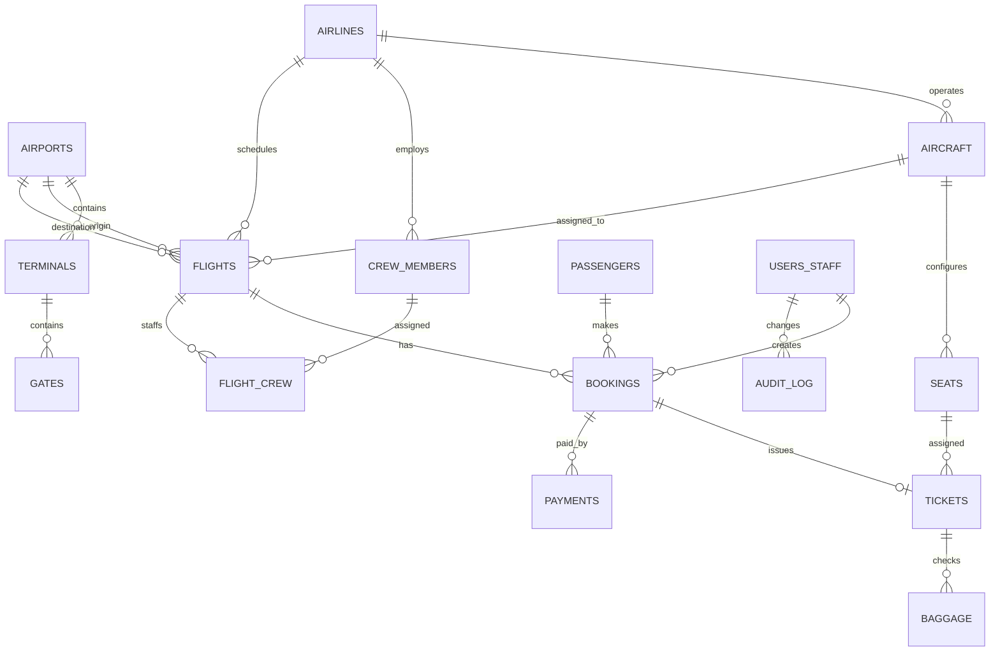

# Airport Management System (PostgreSQL 15+)

Normalized relational schema and sample business logic for airports, airlines, aircraft, schedules, passengers, reservations, tickets, payments, baggage, gates, staff, and crew.

## Web frontend

The responsive React + Vite application lives in `src/`. It uses the local mock API by default and mirrors the SQL objects with strict TypeScript interfaces. To run the frontend:

```sh
npm install
npm run dev
```

Then open the URL printed by Vite. Use the left navigation to explore the operations dashboard and entity pages, or open **New booking** for the multi-step booking flow. The demo role can be cycled from the staff profile at the top right. `Ctrl+K` searches pages and records.

The browser demo uses `localStorage` so edits, bookings, cancellations, role selection, and theme preference survive refreshes in the same browser. It is a mock data service; PostgreSQL is not called by the frontend. Run `npm run test:api` for automated booking, seat exclusivity, refund, flight status, and crew assignment checks.

### Frontend folder structure

```text
src/
├── api/mock.ts              -- Local API and realistic schema-shaped data
├── components/ui.tsx        -- Data table, badges, cards, headers, toast
├── components/CrudDrawer.tsx -- Validated create/edit/delete forms
├── components/shared.tsx    -- Shared confirmation and empty-state UI
├── pages/
│   ├── Dashboard.tsx        -- Operations KPIs and Recharts charts
│   ├── Entities.tsx         -- Flights and each entity management screen
│   ├── Details.tsx          -- Flight, booking, and passenger details
│   └── BookingWizard.tsx    -- Search, seat selection, passenger, payment, pass
├── types/index.ts           -- Interfaces for every database table
├── App.tsx                  -- Responsive shell, routing, search, role controls
├── main.tsx                 -- React, router, and TanStack Query entry
└── styles.css               -- Responsive light/dark aviation visual system
```

### Screenshots

Suggested screenshots for a product walkthrough: `dashboard.png`, `flight-operations.png`, `booking-seat-map.png`, `boarding-pass.png`, `airport-network.png`, and `fleet-management.png`. Capture them from the running Vite app at desktop and mobile widths.

### Connecting a PostgreSQL-backed API

The browser must call a REST service rather than connect directly to PostgreSQL. Keep the existing SQL schema as the source of truth, expose endpoints from a Node/Express service using `pg`, and replace `src/api/mock.ts` with an adapter that returns the same response shapes. Suggested resource endpoints are `GET /api/airports`, `/airlines`, `/aircraft`, `/flights`, `/passengers`, `/bookings`, `/tickets`, `/payments`, `/baggage`, `/crew-members`, `/flight-crew`, `/staff-users`, and `/audit-log`. Create and cancel bookings through transactional API endpoints that call the database booking functions. Map the UI's `staff_users` label to the SQL table `users_staff`, and convert snake_case JSON without renaming fields so the TypeScript contracts remain aligned.

## Requirements

- PostgreSQL 15 or newer
- `psql`
- Permission to create the `citext` extension in the target database (commonly available in standard PostgreSQL installations)

## Setup

Create a dedicated database, then run the scripts in this order:

```powershell
createdb airport_management
psql -d airport_management -v ON_ERROR_STOP=1 -f schema.sql
psql -d airport_management -v ON_ERROR_STOP=1 -f seed_data.sql
psql -d airport_management -v ON_ERROR_STOP=1 -f transaction_examples.sql
psql -d airport_management -v ON_ERROR_STOP=1 -f queries.sql
```

With a connection URL, replace `-d airport_management` with `"$DATABASE_URL"` (or the appropriate shell syntax). `schema.sql` drops and recreates this project's named tables and enum types; use a dedicated database. The seed script inserts sample records and is intended to run once after the schema. The transaction examples create a sample booking and then demonstrate cancellation, so running them changes sample booking state.

## Folder structure

```text
.
├── schema.sql                 -- Types, tables, constraints, indexes, functions, triggers, views
├── seed_data.sql              -- Airports, airlines, aircraft, flights, people, 30 bookings, etc.
├── transaction_examples.sql   -- Atomic booking and cancellation examples
├── queries.sql                -- 17 example reporting queries
└── README.md                  -- Setup and design notes
```

## Main design choices

- Surrogate primary keys use `BIGINT GENERATED BY DEFAULT AS IDENTITY`.
- `flight_status`, `seat_class`, `booking_status`, `ticket_status`, `payment_status`, and `staff_role` are PostgreSQL enums; small evolving labels such as baggage status and payment method use checks.
- Aircraft seats are stored once by aircraft. A ticket assigns one physical seat to one flight. A partial unique index prevents two active tickets from claiming the same flight seat; cancelled tickets are voided so a seat can be resold.
- `book_ticket()` locks the flight row, validates the aircraft/seat relationship, and inserts the booking, ticket, and successful payment in one caller transaction. The unique index is a second concurrency guard.
- Ticket composite foreign keys enforce that its seat belongs to the aircraft assigned to its flight, and that the booking belongs to that same flight. Flights also enforce that aircraft and airline match.
- `trg_sync_flight_status` derives a status when a flight row is inserted or relevant scheduling/actual-time fields change. Time alone does not invoke a trigger; operational systems should update actual times when events occur.
- Booking audit rows retain old/new JSONB snapshots. Revenue is derived from payment events, and refunds are shown separately and subtracted for net revenue.
- For audit attribution on booking updates, set the transaction-local PostgreSQL setting `app.staff_id` to a valid `users_staff.staff_id`; inserts use `bookings.created_by`.

## ER overview

`PK` marks a primary key; `FK` marks a foreign key. All identity columns are `BIGINT GENERATED BY DEFAULT AS IDENTITY`.

| Table | Purpose and columns (type; keys marked) |
|---|---|
| `airports` | Airport directory: `airport_id BIGINT PK`, `iata_code CHAR(3) UNIQUE`, `icao_code CHAR(4) UNIQUE NULL`, `name TEXT`, `city TEXT`, `country TEXT`, `timezone TEXT`, `created_at TIMESTAMPTZ`. |
| `airlines` | Carrier directory: `airline_id BIGINT PK`, `iata_code CHAR(2) UNIQUE`, `name TEXT UNIQUE`, `country TEXT`, `active BOOLEAN`. |
| `aircraft` | Fleet: `aircraft_id BIGINT PK`, `airline_id BIGINT FK`, `registration VARCHAR(12) UNIQUE`, `model TEXT`, `manufacturer TEXT`, `in_service BOOLEAN`; `(aircraft_id, airline_id)` is also unique for flight consistency. |
| `terminals` | Airport terminal: `terminal_id BIGINT PK`, `airport_id BIGINT FK`, `terminal_code VARCHAR(8)`, `name TEXT NULL`; unique by `(airport_id, terminal_code)`. |
| `gates` | Airport boarding gate: `gate_id BIGINT PK`, `terminal_id BIGINT FK`, `airport_id BIGINT`, `gate_code VARCHAR(8)`; composite FK `(terminal_id, airport_id)` to `terminals`, unique `(airport_id, gate_code)`. |
| `users_staff` | Internal operators: `staff_id BIGINT PK`, `email CITEXT UNIQUE`, `full_name TEXT`, `role staff_role`, `active BOOLEAN`, `created_at TIMESTAMPTZ`. |
| `crew_members` | Carrier employees: `crew_member_id BIGINT PK`, `airline_id BIGINT FK`, `employee_number VARCHAR(24) UNIQUE`, `full_name TEXT`, `job_title TEXT`, `active BOOLEAN`. |
| `passengers` | Travelers: `passenger_id BIGINT PK`, `email CITEXT UNIQUE`, `first_name TEXT`, `last_name TEXT`, `date_of_birth DATE`, `passport_number VARCHAR(20) UNIQUE NULL`, `passport_country TEXT NULL`, `created_at TIMESTAMPTZ`. |
| `seats` | Aircraft seat map: `seat_id BIGINT PK`, `aircraft_id BIGINT FK`, `seat_number VARCHAR(5)`, `class seat_class`; unique `(aircraft_id, seat_number)`. |
| `flights` | Scheduled flight leg: `flight_id BIGINT PK`, `airline_id BIGINT FK`, `aircraft_id BIGINT FK`, `flight_number VARCHAR(8)`, `origin_airport_id BIGINT FK`, `destination_airport_id BIGINT FK`, `departure_gate_id BIGINT FK NULL`, `arrival_gate_id BIGINT FK NULL`, `departure_at TIMESTAMPTZ`, `arrival_at TIMESTAMPTZ`, `actual_departure_at TIMESTAMPTZ NULL`, `actual_arrival_at TIMESTAMPTZ NULL`, `status flight_status`; aircraft must belong to carrier. |
| `flight_crew` | Flight/crew assignment: `flight_id BIGINT PK/FK`, `crew_member_id BIGINT PK/FK`, `assignment_role TEXT`; composite PK `(flight_id, crew_member_id)`. |
| `bookings` | Passenger reservation: `booking_id BIGINT PK`, `booking_reference VARCHAR(12) UNIQUE`, `passenger_id BIGINT FK`, `flight_id BIGINT FK`, `status booking_status`, `booked_at TIMESTAMPTZ`, `cancelled_at TIMESTAMPTZ NULL`, `created_by BIGINT FK NULL`. |
| `tickets` | Fare and seat assignment: `ticket_id BIGINT PK`, `booking_id BIGINT UNIQUE/FK`, `flight_id BIGINT FK`, `aircraft_id BIGINT FK`, `seat_id BIGINT FK`, `status ticket_status`, `fare NUMERIC(10,2)`, `issued_at TIMESTAMPTZ`; composite FKs bind booking, flight, aircraft, and seat. |
| `payments` | Payment attempts/refunds: `payment_id BIGINT PK`, `booking_id BIGINT FK`, `amount NUMERIC(10,2)`, `currency CHAR(3)`, `method TEXT`, `status payment_status`, `transaction_reference VARCHAR(40) UNIQUE NULL`, `paid_at TIMESTAMPTZ NULL`, `created_at TIMESTAMPTZ`. |
| `baggage` | Checked bag: `baggage_id BIGINT PK`, `ticket_id BIGINT FK`, `tag_number VARCHAR(24) UNIQUE`, `weight_kg NUMERIC(6,2)`, `status TEXT`, `checked_in_at TIMESTAMPTZ`. |
| `audit_log` | Booking change history: `audit_id BIGINT PK`, `table_name TEXT`, `record_id BIGINT NULL`, `operation TEXT`, `changed_at TIMESTAMPTZ`, `changed_by BIGINT FK NULL`, `old_values JSONB NULL`, `new_values JSONB NULL`. |

### Relationships

- **1:N:** airline→aircraft, airline→crew_members, airline→flights; airport→terminals and airport→origin/destination flights; terminal→gates; aircraft→seats and aircraft→flights; passenger→bookings; flight→bookings and flight→flight_crew; booking→payments; ticket→baggage; staff user→bookings/audit entries.
- **1:0..1:** booking→ticket (a booking has at most one ticket, enforced by `tickets.booking_id UNIQUE`; during reservation processing it may have none).
- **M:N:** flights↔crew_members through `flight_crew`.
- **Seat assignment:** a seat belongs to one aircraft; tickets assign it to flights for that aircraft. The partial unique index permits at most one active ticket for each `(flight_id, seat_id)`.



## Normalization

The core entities and their attributes are stored once: airport, airline, aircraft, passenger, crew, seat, flight, booking, ticket, payment, baggage, gate, and staff. The many-to-many flight/crew assignment is isolated in `flight_crew`. Route endpoints reference airports instead of duplicating airport names. Seat class belongs to the physical aircraft seat; fare belongs to the ticket sale. Views are derived and do not store duplicated business facts. `audit_log` intentionally stores historical JSON snapshots, and `airline_revenue_summary` calculates aggregates at query time, so neither is a denormalized operational source of truth.

## Business logic objects

- Views: `upcoming_flights`, `available_seats_per_flight`, `passenger_itinerary`, `airline_revenue_summary`
- Functions: `book_ticket(...)`, `cancel_booking(booking_id)`, `get_available_seats(flight_id)`
- Triggers: flight status synchronization, ticket assignment validation, booking audit capture

`queries.sql` includes joins, grouped summaries, `HAVING`, subqueries, CTEs, and window functions. `transaction_examples.sql` demonstrates explicit `BEGIN`/`COMMIT`; if a statement fails, roll back the open transaction.
